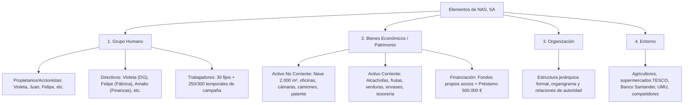
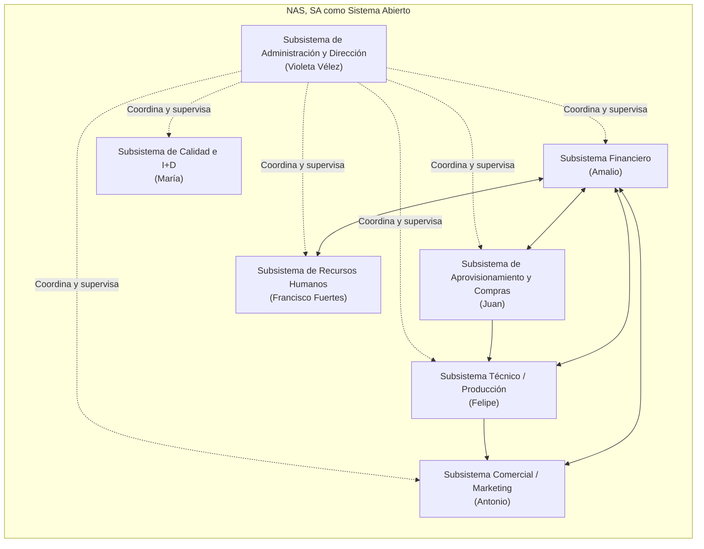

# 📝 Prácticas y Casos Resueltos — Tema 1: La Empresa

- **Asignatura:** Administración de Empresas (Cód. 2345)
- **Tema:** Tema 1 — La Empresa (Concepto, Elementos, Tipologías y la Empresa como Sistema)
- **Profesorado:** Jorge Monllor Domínguez y Juan José Peláez Ibarrondo (Grupo 5)
- **Documento fuente oficial:** [📄 Tema 1n Practicas ADE.pdf](./Tema%201n%20Practicas%20ADE.pdf)

---

## 🏢 Caso Práctico Oficial de Clase: "Juan Juárez y Nuevos Alimentos del Sureste, SA (NAS, SA)"

### 📖 Enunciado y Antecedentes
Juan Juárez comenzó como titular de un negocio individual de conservas vegetales de alcachofas en el polígono "Fase 2000" de Beniajún, con 15 trabajadores. Tras una excelente trayectoria y acuerdos con agricultores, decide unirse a otros empresarios del sector agrario, conservero y auxiliar (Felipe, Antonio, Amalio, María, Violeta Vélez y Francisco Fuertes) para fundar **Nuevos Alimentos del Sureste, SA (NAS, SA)** en el Polígono Industrial de San Ginés. 

La empresa cuenta con:
- Una parcela de $10.000\text{ m}^2$, nave industrial de $2.000\text{ m}^2$ y oficinas de $200\text{ m}^2$.
- Instalaciones de última generación capaces de producir $10.000\text{ Tm}$ anuales, 5 cámaras frigoríficas, 2 carretillas elevadoras, 4 furgonetas y 2 camiones.
- Un préstamo bancario de $500.000$ € concedido por Banco Santander.
- Proceso técnico patentado de corte, lavado y envasado aséptico que alarga la vida útil de los alimentos.
- Cátedra de investigación en I+D firmada con la Universidad de Murcia.
- Plantilla de 30 trabajadores fijos (un tercio altamente cualificados con formación continua) y contratación de entre 250 y 300 trabajadores temporales en época de campaña.

---

## 🎯 Resolución Oficial de las Cuestiones de Clase

### Cuestión 1: Identificación y clasificación socioeconómica de las empresas que aparecen en el texto

| Empresa | Criterio de Propiedad del Capital | Criterio de Tamaño (Criterios UE: Plantilla / Cifra Negocio) | Sector de Actividad | Ámbito Geográfico | Forma Jurídica |
| :--- | :--- | :--- | :--- | :--- | :--- |
| **Negocio inicial de Juan Juárez** | **Privada** (capital 100% de Juan Juárez). | **Pequeña empresa** (15 trabajadores, $< 50$ empleados). | **Secundario / Industrial** (transformación agroalimentaria de conservas). | **Local / Regional** (Murcia y agricultores de la zona). | **Empresario Individual / Autónomo**. Responsabilidad ilimitada. |
| **Nuevos Alimentos del Sureste, SA (NAS, SA)** | **Privada** (propiedad de varios socios fundadores). | **Mediana / Gran empresa en campaña:** Fija: 30 trabajadores (Pequeña). En campaña: $>250$ empleados (Pasa a considerarse **Gran Empresa** por volumen laboral estacional). | **Secundario / Agroindustrial** (transformación, corte, envasado aséptico y distribución). | **Nacional e Internacional** (vende a cadenas de supermercados nacionales y distribuidores internacionales). | **Sociedad Anónima (S.A.)**. Sociedad mercantil capitalista, capital dividido en acciones, responsabilidad limitada al capital aportado. |
| **Banco Santander** | **Privada** (cotizada en bolsa, capital disperso). | **Gran Empresa** ($>250$ empleados, facturación $>50$ M€). | **Terciario / Servicios financieros**. | **Multinacional / Global**. | **Sociedad Anónima**. |
| **Universidad de Murcia (UMU)** | **Pública** (financiada por fondos públicos autonómicos). | **Gran Organización** ($>250$ trabajadores). | **Terciario / Educación superior e I+D**. | **Regional / Nacional**. | **Organismo público universitario**. |

---

### Cuestión 2: Elementos de la empresa NAS, SA

Siguiendo la clasificación teórica clásica de los elementos empresariales:

1. **El Grupo Humano (Factor Pasivo y Activo):**
   - **Propietarios y socios capitalistas:** Juan Juárez, Felipe, Antonio, Amalio, María y Violeta Vélez.
   - **Equipo directivo:** Violeta Vélez (Directora General), Juan (Director de Compras), Felipe (Jefe de Fábrica), Antonio (Comercial), Amalio (Contabilidad y Finanzas), María (Calidad) y Francisco Fuertes (Recursos Humanos).
   - **Personal operativo:** 30 empleados fijos de alta cualificación y entre 250 y 300 trabajadores eventuales en campaña.
2. **Bienes Económicos y Materiales (Patrimonio):**
   - **Bienes duraderos (Inmovilizado / Activo No Corriente):** Parcela de $10.000\text{ m}^2$, nave de $2.000\text{ m}^2$, oficinas de $200\text{ m}^2$, maquinaria de envasado aséptico de última generación, 5 cámaras frigoríficas, 2 carretillas, 4 furgonetas y 2 camiones.
   - **Intangibles / Capital Intelectual:** La **patente** del sistema de corte y envasado aséptico, la reputación de marca, el know-how logístico y los acuerdos de la Cátedra con la UMU.
   - **Bienes corrientes (Activo Corriente):** Materias primas agrícolas (alcachofas, frutas), envases, productos terminados y saldos de tesorería.
   - **Recursos financieros:** Capital social aportado por los socios y deuda bancaria a largo plazo ($500.000$ € con Banco Santander).
3. **La Organización:** Estructura formal con división de funciones departamentales (compras, producción, finanzas, comercial, calidad y RRHH), líneas de jerarquía, coordinación y flujos de información.
4. **El Entorno:** El mercado agroalimentario regional, los agricultores proveedores, la gran distribución (supermercados), la legislación higiénico-sanitaria y la UMU.

---

### Cuestión 3: Identificación de los subsistemas de NAS, SA y Enfoque de Sistemas

La empresa es un **sistema socio-técnico abierto**. Está formada por los siguientes subsistemas funcionales:

- **Subsistema de Aprovisionamiento (Juan):** Gestión de compras de materias primas a los agricultores de la comarca y control del almacén.
- **Subsistema de Producción (Felipe):** Operación de la maquinaria patentada de corte y envasado aséptico, cámaras frigoríficas y transformación física de los alimentos.
- **Subsistema Comercial (Antonio):** Negociación y venta a cadenas de supermercados nacionales y distribuidores internacionales.
- **Subsistema Financiero (Amalio):** Gestión de la tesorería, contabilidad y administración del préstamo de $500.000$ € de Banco Santander.
- **Subsistema de Recursos Humanos (Francisco Fuertes):** Contratación de 250-300 trabajadores en campaña, gestión del personal fijo y planes de formación continua.
- **Subsistema de Calidad e I+D (María):** Control microbiológico, salubridad y proyectos conjuntos con la Cátedra de la UMU.
- **Subsistema de Dirección (Violeta Vélez):** Planificación global, toma de decisiones estratégicas, asignación de recursos y control.

#### 💡 Ejemplo de la necesidad de considerar a la empresa como un SISTEMA (Sinergia e Interdependencia):
> *Ejemplo real:* Si el **Subsistema Comercial (Antonio)** cierra un contrato millonario con una cadena de supermercados para entregar $5.000\text{ Tm}$ de alcachofas envasadas en noviembre, esta decisión no puede ejecutarse de forma aislada. Requiere que:
> 1. El **Subsistema Financiero (Amalio)** garantice liquidez para pagar a proveedores.
> 2. El **Subsistema de Aprovisionamiento (Juan)** compre las alcachofas frescas a tiempo.
> 3. El **Subsistema de RRHH (Francisco)** contrate a los 250 operarios eventuales necesarios.
> 4. El **Subsistema de Producción (Felipe)** programe los turnos de las cámaras y la maquinaria.
> 5. El **Subsistema de Calidad (María)** audite el proceso para evitar partidas contaminadas.
>
> Si falla uno solo de los subsistemas, **toda la empresa fracasa**. Esto demuestra el **principio de holismo y sinergia:** *el todo es mayor que la simple suma de las partes*.

---

### Cuestión 4: Entradas (Inputs) y Salidas (Outputs) de NAS, SA

| Entradas (Inputs del Entorno a la Empresa) | Proceso de Transformación (Caja Negra) | Salidas (Outputs de la Empresa al Entorno) |
| :--- | :--- | :--- |
| **Materiales:** Frutas, alcachofas, hortalizas frescas, envases, tarros, tapas, etiquetas y suministros de energía. | **Tecnología patentada:** Limpieza aséptica, corte automatizado, esterilización, envasado hermético, congelación y control de calidad. | **Bienes económicos:** Conservas vegetales, alimentos frescos preparados y productos de IV/V gama listos para el consumo. |
| **Humanos:** Horas de trabajo de operarios cualificados, técnicos de laboratorio, directivos y mano de obra temporal. | **Gestión logística:** Enfriamiento en cámaras frigoríficas, almacenamiento y preparación de pallets. | **Remuneraciones y empleo:** Salarios abonados a trabajadores de la comarca y generación de empleo estacional. |
| **Financieros:** $500.000$ € del préstamo de Santander y aportaciones de capital de los socios. | **I+D+i:** Ensayos microbiológicos y experimentación agronómica junto con la Universidad de Murcia. | **Flujos financieros:** Devolución de cuotas del préstamo e intereses al banco, pago a proveedores y reparto de dividendos. |
| **Informativos:** Previsiones de demanda de supermercados, tendencias de consumo saludable y normativas sanitarias. | **Coordinación organizativa:** Procesos de planificación, control y asignación de recursos por la dirección general. | **Impacto social y residuos:** Pago de tributos públicos, publicaciones/patentes de I+D y residuos vegetales (tratados bajo normativa medioambiental). |
