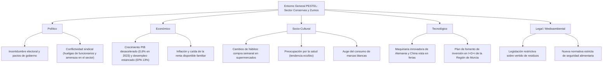
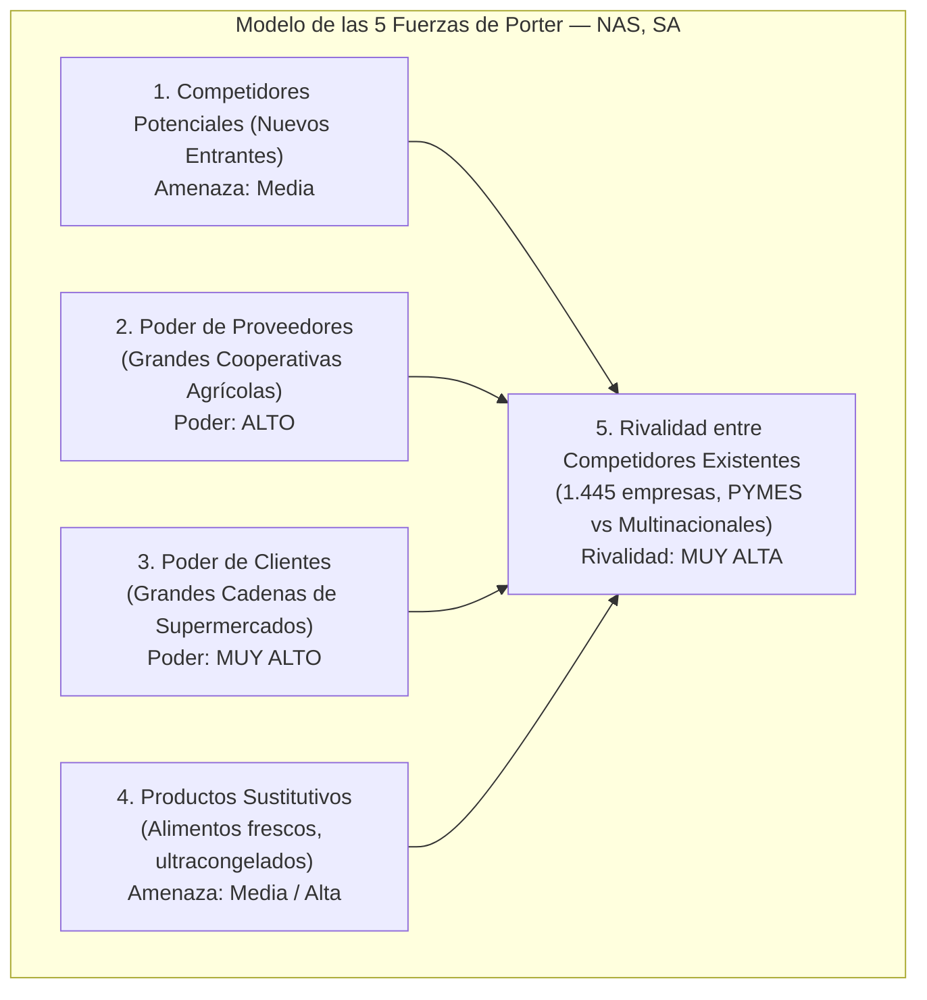

# 📝 Prácticas y Casos de Entorno — Tema 2: La Empresa y su Entorno

- **Asignatura:** Administración de Empresas (Cód. 2345)
- **Tema:** Tema 2 — La Empresa y su Entorno (Entorno General PEST/PESTEL y Entorno Específico de Porter)
- **Profesorado:** Jorge Monllor Domínguez y Juan José Peláez Ibarrondo (Grupo 5)
- **Documento fuente oficial:** [📄 Tema 2n Practicas ADE.pdf](./Tema%202n%20Practicas%20ADE.pdf)

---

## 🏢 Caso Práctico Oficial de Clase: "Análisis Estratégico del Entorno para NAS, SA"

### 📖 Contexto del Sector (Datos Oficiales del Enunciado)
- **Sector nacional:** La industria de conservas vegetales y zumos en España cuenta con más de $1.445$ empresas ($+5,2\%$ respecto a 2019), con una cifra de negocio de más de $11.300$ millones de euros ($9\%$ de la cifra nacional). Las exportaciones alcanzaron $44.493$ millones de euros en 2022.
- **Sector regional (Murcia):** Es la actividad con mayor arraigo y dinamismo agroalimentario de la Región. Alcanza casi $2.000$ millones de euros ($34\%$ de la industria alimentaria regional) y emplea directamente a unas $7.500$ personas ($9\%$ del empleo industrial). Coexisten PYMES tradicionales con grandes compañías de capital extranjero que apuestan por nuevos segmentos (zumos naturales, 3ª y 4ª gama, productos dietéticos).
- **Informe de análisis estratégico de NAS, SA:** El consejo de administración recibe un informe con 9 factores clave del entorno político, económico, social, legal y de mercado.

---

## 🎯 Resolución Oficial de las Cuestiones de Clase

### Cuestión 1: Identificación y análisis de los factores del Entorno General (Método PEST / PESTEL)

El análisis del entorno general abarca aquellos factores macroeconómicos, sociopolíticos y tecnológicos que afectan a todas las empresas del sector por igual, sobre los cuales la empresa no tiene control directo pero a los que debe adaptarse.

| Factor del Texto | Dimensión PESTEL | Evolución en el Entorno | Impacto Estratégico sobre NAS, SA y el Sector | ¿Oportunidad o Amenaza? |
| :--- | :---: | :--- | :--- | :---: |
| **Incertidumbre política y elecciones municipales/generales** | **Político** | Negociaciones complejas para formar gobiernos locales y convocatoria de elecciones generales. | Retraso en subvenciones, parálisis temporal de políticas de apoyo agrario e incertidumbre inversora. | ⚠️ **Amenaza** |
| **Huelgas de funcionarios (justicia, hacienda, trabajo) y posible huelga sectorial** | **Político-Social** | Elevada tensión sindical y conflictividad laboral reivindicando subidas salariales. | Paralización burocrática de trámites aduaneros/sanitarios y riesgo de interrupción de la producción en plena campaña agrícola. | ⚠️ **Amenaza** |
| **Nueva legislación ambiental (prohibición de vertido de residuos)** | **Legal / Ecológico** | Mayor rigor ecologista y presión institucional contra la contaminación de aguas y suelos. | Obliga a acometer inversiones en plantas de tratamiento y depuración de residuos orgánicos; eleva costes fijos. | ⚠️ **Amenaza a c/p** (puede ser **Oportunidad** si se valorizan subproductos). |
| **Nueva legislación de seguridad alimentaria y presión de consumidores** | **Legal** | Normas higiénico-sanitarias y de trazabilidad mucho más estrictas ante alertas alimentarias. | Incrementa los costes de homologación y auditoría; sin embargo, premia a empresas con patentes asépticas como NAS, SA. | 💡 **Oportunidad** para NAS, SA (tiene ventaja competitiva con su proceso aséptico patentado). |
| **Desaceleración del PIB (de 5,5% a 0,6%) y paro al 13%** | **Económico** | Enfriamiento económico, desaceleración del consumo privado y pérdida de poder adquisitivo. | Contracción del gasto de los hogares en productos gourmet o de gama alta; estancamiento del mercado interno. | ⚠️ **Amenaza** |
| **Inflación y auge de las marcas blancas (MDD)** | **Económico / Social** | Las familias reducen su presupuesto de cesta de la compra y se refugian en la marca del distribuidor. | Canibalización de marcas de fabricante; presión de los supermercados para fabricar marca blanca a márgenes mínimos. | ⚠️ **Amenaza** (para marca propia) / 💡 **Oportunidad** (si NAS vende a supermercados como interproveedor). |
| **Nuevos estilos de vida: compra en supermercados y falta de tiempo para cocinar** | **Socio-Cultural** | Menos tiempo en casa; auge de productos listos para consumir (3ª, 4ª y 5ª gama) y compra única semanal en hipermercados. | Crecimiento exponencial de ensaladas, platos preparados refrigerados y conservas de fácil apertura; pérdida de relevancia del comercio tradicional. | 💡 **Oportunidad** |
| **Preocupación por la salud: auge de productos 'eco', 'bio' y frescos** | **Socio-Cultural** | Búsqueda activa de alimentos saludables, sin aditivos artificiales ni azúcares añadidos. | Posibilidad de cobrar precios superiores (*premium*) en líneas bio y zumos naturales con valor nutricional conservado. | 💡 **Oportunidad** |
| **Nuevas tecnologías y maquinaria innovadora (Alemania y China)** | **Tecnológico** | Automatización avanzada, robótica y maquinaria de envasado de alta velocidad disponibles en el mercado internacional. | Posibilidad de mejorar la eficiencia productiva, reducir mermas y abaratar costes unitarios mediante modernización. | 💡 **Oportunidad** |
| **Plan regional de I+D+i de la Región de Murcia para PYMES** | **Político-Tecnológico** | Subvenciones y ayudas públicas para incorporar TIC e investigación aplicada. | Financiación ventajosa para la Cátedra con la UMU y para digitalizar la trazabilidad de NAS, SA. | 💡 **Oportunidad** |

---

### Cuestión 2: Análisis del Entorno Específico mediante las 5 Fuerzas Competitivas de Michael Porter

El modelo de Porter evalúa el atractivo de la industria agroalimentaria de conservas y zumos y la capacidad de las empresas para obtener rentabilidades sostenibles:

#### 1. Rivalidad entre Competidores Actuales: **MUY ALTA** 🔴
- **Elevado número de empresas:** Más de $1.445$ operadores en España y convivencia en Murcia de cientos de PYMES con grandes multinacionales respaldadas por capital extranjero.
- **Mercado maduro con crecimiento lento:** El sector crece a ritmos moderados ($+5,2\%$ en 5 años), lo que obliga a ganar cuota de mercado a costa de los rivales.
- **Diferenciación polarizada:** Los productos estándar (alcachofa en lata tradicional) son *commodities* donde la batalla es a muerte en precios, mientras que las grandes compañías compiten con fuertes campañas publicitarias en zumos naturales y productos dietéticos.

#### 2. Poder de Negociación de los Proveedores: **ALTO** 🔴
- **Concentración de los agricultores:** El texto señala que los agricultores se han agrupado en **grandes cooperativas agrarias**, ganando tamaño y fuerza negociadora.
- **Desvinculación de las ayudas de la UE:** Al suprimirse la obligación comunitaria de entregar la producción al sector conservero para cobrar la subvención, los agricultores son libres de vender al mejor postor (fresco, exportación directa o industria), aumentando su poder sobre NAS, SA.
- **Impacto:** Menor margen para imponer precios a la baja a la materia prima; riesgo de rotura de stocks en campañas de escasez.

#### 3. Poder de Negociación de los Clientes (Supermercados): **MUY ALTO** 🔴🔴
- **Hiperconcentración de la distribución:** Los consumidores compran una vez por semana en grandes cadenas de supermercados e hipermercados (Mercadona, Carrefour, TESCO, Lidl), concentrando las compras del sector en muy pocas manos.
- **Bajos costes de cambio:** Los supermercados pueden sustituir a un proveedor conservero por otro de un día para otro o sustituirlo por su propia **marca blanca (MDD)**.
- **Capacidad de presión:** Exigen entregas "just in time", márgenes reducidos y descuentos por volumen (rappels).

#### 4. Amenaza de Productos Sustitutivos: **MEDIA / ALTA** 🟡
- Los alimentos frescos diarios, las verduras ultracongeladas y los platos preparados refrigerados de conveniencia compiten directamente con las conservas tradicionales de lata o tarro.
- No obstante, la tecnología de NAS, SA (corte y envasado aséptico que mantiene el sabor fresco) mitiga esta amenaza al posicionar el producto cerca de la calidad del producto recién cosechado.

#### 5. Amenaza de Nuevos Competidores Entrantes: **MEDIA** 🟡
- **Barreras de entrada existentes:**
  - Se requieren fuertes inversiones de capital en maquinaria, naves, cámaras frigoríficas e instalaciones asépticas.
  - La estricta normativa de seguridad alimentaria y la prohibición de vertidos actúan como freno legal para operadores improvisados.
- **Facilitadores de entrada:**
  - Acceso a maquinaria tecnológica china y alemana más económica y posibilidad de entrada de fondos de capital extranjero adquiriendo conserveras locales.

---

### 📌 Conclusión Estratégica para NAS, SA
> El sector agroalimentario de conservas y zumos presenta un **atractivo moderado-bajo en su vertiente tradicional** debido al aplastante poder de los supermercados y la presión en costes de los agricultores agrupados en cooperativas.  
> La vía de éxito para NAS, SA reside en **alejarse de la batalla del precio estándar** y explotar su **estrategia de diferenciación**: apoyarse en su **patente aséptica**, certificar líneas **eco/bio** y colaborar con la **Cátedra de la UMU** para liderar la innovación en productos saludables de alto margen.
