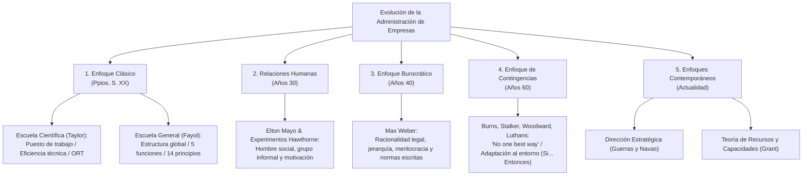
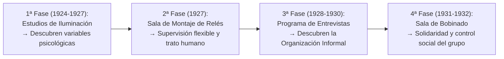
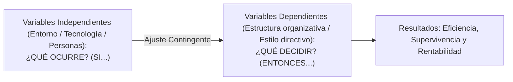

# 🏛️ Administración de Empresas — Tema 3: Evolución del Pensamiento Administrativo

- **Asignatura:** Administración de Empresas (Cód. 2345)
- **Titulación:** Grado en ADE — Facultad de Economía y Empresa (Universidad de Murcia)
- **Grupo:** Grupo 5 (Turno Tarde) · **Profesorado:** Jorge Monllor Domínguez y Juan José Peláez Ibarrondo
- **Documento fuente oficial:** [📄 Tema 3n ADE.pdf](./Tema%203n%20ADE.pdf)
- **Objetivo del tema:** Comprender el desarrollo histórico de las escuelas de pensamiento directivo, desde los enfoques clásicos mecanicistas hasta las teorías humanistas, burocráticas y contingentes actuales.

---

## 🧭 Mapa Conceptual del Pensamiento Administrativo

---

## 3.1. 📜 Introducción y Etapas Históricas

La Administración de Empresas como disciplina científica ha atravesado tres grandes fases:

| Etapa Histórica | Periodo | Hitos y Autores Principales | Características |
| :--- | :---: | :--- | :--- |
| **1. Etapa de Origen** | Hasta s. XVIII | - **Luca Pacioli:** Creación de la partida doble y técnicas contables mercantiles. - **Peri y Savary:** Reglamentación de la actividad comercial. - **Escuela de Salamanca:** Primeras reflexiones sobre valor y precio. | Prácticas empíricas rudimentarias asociadas al comercio y la contabilidad artesanal. |
| **2. Etapa Precursora** | Hasta s. XX | - **Revolución Industrial y Liberalismo (s. XVIII):** Adam Smith. - **Siglo XIX:** Separación formal entre Administración de Empresas y Economía Política (Gutenberg). | Crecimiento del tamaño de las fábricas; necesidad de ordenar el trabajo industrial masivo. |
| **3. Etapa de Explosión** | Hasta hoy | - Escuelas clásicas, sociológicas, psicológicas, sistémicas y estratégicas. | **Multidisciplinar, dinámica, heterogénea** y fundamentada en la investigación empírica. |

---

## 3.2. ⚙️ El Enfoque Clásico

Surge a principios del siglo XX para responder a la necesidad de aumentar la productividad ante mercados en rápida expansión, escasez de mano de obra cualificada y desorden en los talleres fabriles. Se divide en dos ramas complementarias:

### 3.2.1. Escuela de la Administración Científica (Frederick W. Taylor, 1911)
- **Foco de atención:** El **nivel operativo / puesto de trabajo** (el taller y las tareas del operario).
- **Objetivo supremo:** Alcanzar la **eficiencia técnica** y la máxima productividad descubriendo *"The One Best Way"* (la única mejor manera de ejecutar cada tarea).
- **Problemas detectados por Taylor en las fábricas:**
  1. Holgazanería sistemática de los obreros.
  2. Desconocimiento de los tiempos y métodos por parte de la gerencia.
  3. Falta de uniformidad en las herramientas y técnicas de trabajo.
- **Fundamentos teóricos:**
  - Identidad de intereses: patrón y obrero deben ganar más (prosperidad monetaria mutua).
  - Concepción del trabajador como **"Homo Economicus"**: el obrero es perezoso por naturaleza y solo se motiva mediante incentivos económicos directos (salario por pieza producida).
  - Separación tajante entre quienes piensan (gerencia) y quienes ejecutan (obreros).

#### Los 4 Principios de Taylor:
1. **Principio de Planificación:** Sustituir el criterio individual y la improvisación del obrero por métodos y procedimientos científicos contrastados.
2. **Principio de Preparación / Selección:** Seleccionar científicamente a los trabajadores según sus aptitudes y entrenarlos sistemáticamente para su puesto.
3. **Principio de Control:** Controlar el trabajo para certificar que se ejecuta de acuerdo con las normas y planes científicos previstos.
4. **Principio de Ejecución:** Distribuir de forma diferenciada las tareas y responsabilidades entre la dirección (planifica) y los operarios (ejecutan).

#### La Organización Racional del Trabajo (ORT) — Taylor y Gilbreth:
- **Estudio de tiempos y movimientos (Therbligs):** Descomposición de cada tarea en movimientos elementales cronometrados para eliminar tiempos muertos.
- **Estudio de la fatiga humana:** Diseño ergonómico de pausas y posturas para mantener el rendimiento.
- **División del trabajo y especialización extrema:** Cada obrero realiza una única tarea repetitiva.
- **Estandarización:** Unificación de herramientas, maquinaria y materias primas (experimentos de las palas y los lingotes de acero).
- **Supervisión funcional:** Varios capataces especializados asesoran y supervisan al mismo obrero en aspectos técnicos concretos (calidad, velocidad, reparación).

#### ⚠️ Críticas a la Administración Científica:
- Visión mecanicista y deshumanizada del trabajador (tratado como un engranaje o apéndice de la máquina).
- Concepción simplista del salario como única palanca motivadora.
- La excesiva parcelación y monotonía provoca fatiga psicológica, aburrimiento y desafección laboral.
- Ignora la existencia de relaciones sociales y grupos informales dentro del taller.

---

### 3.2.2. Escuela de la Administración General (Henri Fayol, 1916)
- **Foco de atención:** La **estructura formal y la alta dirección** de la empresa en su conjunto (enfoque descendente, *top-down*).
- **Objetivo supremo:** Alcanzar la **eficiencia administrativa** estructurando adecuadamente los órganos de la empresa.

#### Las 6 Funciones Básicas de la Empresa según Fayol:
1. **Técnicas:** Producción y fabricación de bienes y servicios.
2. **Comerciales:** Compras, ventas e intercambios de mercado.
3. **Financieras:** Búsqueda y gestión óptima de los recursos de capital.
4. **De Seguridad:** Protección de los bienes de la empresa y de las personas.
5. **Contables:** Inventarios, balances, costes y estadísticas.
6. **Administrativas (La Función Directiva):** Coordina y supervisa a las otras cinco funciones.

#### El Proceso Administrativo (Las 5 Funciones Directivas de Fayol):
$$\boxed{\text{Prever} \longrightarrow \text{Organizar} \longrightarrow \text{Dirigir} \longrightarrow \text{Coordinar} \longrightarrow \text{Controlar}}$$

#### Los 14 Principios Generales de la Administración de Fayol:
1. **División del trabajo:** Especialización para aumentar la destreza y eficiencia.
2. **Autoridad y responsabilidad:** El derecho a dar órdenes acompañado del deber de rendir cuentas.
3. **Disciplina:** Obediencia y cumplimiento de los acuerdos formalizados entre empresa y trabajadores.
4. **Unidad de mando:** **Cada subordinado debe recibir órdenes de un solo jefe** (evita conflictos y contradicciones).
5. **Unidad de dirección:** Un solo jefe y un único plan para todo grupo de actividades que compartan el mismo objetivo.
6. **Subordinación del interés individual al general:** Los intereses de un trabajador o grupo jamás deben prevalecer sobre los de la empresa.
7. **Remuneración justa:** Salarios equitativos que recompensen el esfuerzo y satisfagan a ambas partes.
8. **Centralización:** Concentración del poder decisorio en la cúspide, dosificada según las circunstancias.
9. **Jerarquía (Cadena escalar):** Línea formal de mando desde la máxima autoridad hasta los niveles más bajos.
10. **Orden:** *"Un lugar para cada cosa y cada cosa en su lugar"* (orden material y social).
11. **Equidad:** Justicia, amabilidad y lealtad en el trato con el personal.
12. **Estabilidad del personal:** Limitar la rotación de plantilla; formar a un directivo o empleado requiere tiempo.
13. **Iniciativa:** Estimular la capacidad de concebir y ejecutar planes sin saltarse la autoridad.
14. **Unión del personal (Espíritu de equipo):** Fomentar la armonía y cohesión entre los integrantes de la empresa.

#### ⚠️ Críticas a la Administración General de Fayol:
- Enfoque excesivamente normativo, prescriptivo y formalista.
- Obsesión rígida por la unidad de mando y la centralización jerárquica.
- Ausencia de validación empírica en laboratorio: se basó casi exclusivamente en su experiencia directiva personal en la minería francesa.
- Omite la influencia del entorno exterior (trata a la empresa como un sistema cerrado).

---

## 3.3. 👥 El Enfoque de las Relaciones Humanas (Elton Mayo, 1927–1932)

Surge en EE.UU. como una **reacción contra la deshumanización del enfoque clásico**. 
- **Contexto histórico:** La Gran Depresión de 1929, la creación de la Organización Internacional del Trabajo (OIT en 1919) y el auge de la sociología y psicología del trabajo.
- **Principio nuclear:** **El ser humano es un ser social ("Homo Socialis")**. La productividad no depende únicamente de factores físicos o de la destreza mecánica, sino de variables psicológicas, del clima laboral y de la integración grupal.

### Los Experimentos de Hawthorne (Planta de Western Electric en Chicago):

1. **1.ª Fase — Estudio del impacto del ambiente físico (Iluminación):**
   - Se modificó la intensidad de la luz en el grupo experimental frente al de control.
   - *Hallazgo:* La producción aumentaba tanto al subir la luz como al bajarla. Se concluyó que existía un factor psicológico no controlado: las operarias rendían más porque sabían que estaban siendo observadas e investigadas (*Efecto Hawthorne*).
2. **2.ª Fase — Sala de montaje de relés (Condiciones de trabajo):**
   - Se introdujeron pausas, refrigerios y reducción de jornada con supervisión suave.
   - *Conclusión:* Las operarias disfrutaban del trabajo porque se sentían importantes, tenían libertad de comunicación y el ambiente era amistoso y carente de presiones autoritarias.
3. **3.ª Fase — Programa masivo de entrevistas clínicas:**
   - Se entrevistó confidencialmente a más de 20.000 operarios.
   - *Conclusión:* Emergió la existencia de la **ORGANIZACIÓN INFORMAL**: redes espontáneas de amistad, descontento con incentivos rígidos y lealtad hacia líderes informales no reconocidos en el organigrama.
4. **4.ª Fase — Sala de observación del bobinado de terminales:**
   - Se estudió el comportamiento colectivo dentro de una sala aislada.
   - *Conclusión:* El grupo imponía una **tasa de producción normal** no escrita: penalizaban socialmente al que producía demasiado ("matón" o adulador del jefe) y al que producía de menos ("vago"). **La aceptación social del grupo condicionaba el rendimiento individual.**

#### Conclusiones Principales del Experimento de Hawthorne:
- El nivel de producción es función directa de la **integración y las normas sociales**, no de la capacidad biológica o física.
- Las **recompensas no económicas (reconocimiento, afecto, estatus, pertenencia)** son tan o más motivadoras que el dinero.
- La organización formal convive siempre con la **organización informal**.
- La excesiva especialización del taylorismo destruye el sentido del trabajo y desmotiva.

#### ⚠️ Críticas a la Escuela de Relaciones Humanas:
- Concepción romántica, ingenua e idealizada del trabajador.
- Sesgo manipulativo: en muchos casos se utilizó la psicología como herramienta sutil para que el trabajador se sintiese feliz mientras cumplía los mismos objetivos de producción empresarial.
- Muestra experimental limitada a una única fábrica tecnológica.

---

## 3.4. 📋 El Enfoque Burocrático (Max Weber, 1864–1920)

Frente a la debilidad de las teorías anteriores y ante el gigantesco crecimiento de las empresas públicas y corporaciones a mediados del siglo XX, surge la sociología de las organizaciones de Max Weber.

> 📌 **Definición de Burocracia:** Organización formal humana basada en la **racionalidad**, es decir, en la adecuación estricta de los medios a los fines perseguidos para garantizar la **máxima eficiencia y previsibilidad**.

### Las 10 Características del Modelo Burocrático Ideal:
1. **Carácter legal de las normas y reglamentos:** La organización se rige por un cuerpo normativo exhaustivo escrito que define por anticipado todos los derechos y obligaciones.
2. **Carácter formal de las comunicaciones:** Todo acto, decisión y orden se transmite y archiva rigurosamente **por escrito**.
3. **División racional y sistemática del trabajo:** Cada miembro tiene asignado un puesto con atribuciones y competencias perfectamente delimitadas.
4. **Impersonalidad en las relaciones:** La autoridad se ejerce en base al **cargo**, no a la persona. La obediencia se debe al reglamento, no al individuo.
5. **Jerarquía de autoridad:** Estructura piramidal estricta donde cada nivel inferior está supervisado por uno superior.
6. **Rutinas y procedimientos estandarizados:** Manuales de procedimiento para que ninguna situación quede a la improvisación.
7. **Competencia técnica y meritocracia:** Selección, contratación y ascensos fundamentados en exámenes objetivos, títulos y méritos comprobados, erradicando el nepotismo o enchufismo.
8. **Separación entre administración y propiedad:** El directivo es un profesional especializado asalariado; los dueños del capital no gestionan directamente el día a día.
9. **Profesionalización de los participantes:** Los empleados son especialistas con dedicación exclusiva, contrato indefinido y plan de carrera estructurado.
10. **Previsibilidad total del funcionamiento:** Todo está previsto para que la organización funcione de forma idéntica independientemente de quién ocupe el puesto.

### Balanza del Modelo Burocrático:

| Ventajas del Modelo Ideal | Inconvenientes y Disfunciones Reales (Merton, Selznick) |
| :--- | :--- |
| - Máxima precisión y claridad en funciones. - Rapidez en la toma de decisiones tipificadas. - Previsibilidad y reducción de errores. - Continuidad organizativa ante cambios de personas. - Eliminación de fricciones y discriminaciones personales. | - **Apego ciego al reglamento ("reglamentitis"):** las normas se convierten en un fin en sí mismas. - **Exceso de papeleo, lentitud y formalismo.** - **Extrema resistencia al cambio:** incapacidad de adaptarse a entornos dinámicos. - **Despersonalización y frialdad** en el trato con usuarios y compañeros. - Jerarquía como dogma: nadie decide nada si no está autorizado por escrito en el manual. |

---

## 3.5. 🧩 El Enfoque de Contingencias (Década de 1960)

Desarrollado por autores como **Burns y Stalker (1961)**, **Woodward (1965)**, **Lawrence y Lorsch (1967)** y sistematizado por **Fred Luthans**.

> 💡 **Principio Fundamental del Enfoque Contingente:**  
> **NO existe una única y mejor forma de administrar u organizar válida para todas las empresas (*"No one best way"*). Todo depende de las circunstancias del entorno, la tecnología y las personas.**

### Fundamentos Clave:
1. Las prácticas de gestión no son buenas ni malas por sí mismas; son **eficaces o ineficaces según la situación**.
2. **Esquema condicional de Luthans:** *"Si se da la variable ambiental $X$, entonces la técnica de administración más adecuada es $Y$"*.
3. **Alineamiento con el entorno:** La empresa no puede cambiar el entorno macroeconómico ni las fuerzas de la competencia; por tanto, **debe adaptar de forma flexible sus variables internas** para que no se produzca una ruptura o desfase.

---

## 3.6. 🚀 Extensiones Contemporáneas

1. **Teoría de la Dirección Estratégica (Guerras y Navas, 2008):**
   - Sistema directivo para identificar de forma precoz los cambios del entorno e implementar respuestas rápidas.
   - Búsqueda del ajuste estratégico entre lo que la empresa puede hacer (**Fortalezas y Debilidades internas**) y lo que el entorno le permite (**Oportunidades y Amenazas externas** — Matriz DAFO).
2. **Teoría de los Recursos y Capacidades (Grant, 2006):**
   - Sitúa el origen de la ventaja competitiva sostenible en el interior de la propia empresa: en sus activos tangibles, intangibles (marcas, patentes, reputación) y en sus capacidades distintivas (habilidades para coordinar dichos recursos de forma difícil de imitar por los rivales).

---

## 📊 Tabla Comparativa de Examen: Las 4 Grandes Escuelas

| Escuela | Autor Clave | Foco de Análisis | Concepción del Ser Humano | Factor Clave de Éxito | ¿Válida hoy? |
| :--- | :--- | :--- | :--- | :--- | :--- |
| **Científica** | F.W. Taylor | Puesto de trabajo / Taller operativo | *Homo Economicus* (egoísta, perezoso, motivado por dinero) | Estandarización de tareas, tiempos y movimientos (ORT) | Útil en líneas de montaje industriales automatizadas y comida rápida. |
| **General** | Henri Fayol | Organización global y alta dirección | Estructura formal y jerárquica | 14 principios, unidad de mando y funciones directivas (PODCC) | Base del organigrama tradicional y de la planificación formal. |
| **Relaciones Humanas** | Elton Mayo | Grupos de trabajo y aspectos psicosociales | *Homo Socialis* (ser social motivado por el grupo y reconocimiento) | Clima laboral, liderazgo democrático y comunicación | Clave para gestión del talento, trabajo en equipo y RRHH. |
| **Burocrática** | Max Weber | Estructura legal y procedimientos | Funcionario racional impersonal | Normas escritas, meritocracia y previsibilidad total | Base de la Administración Pública, hospitales y notarías. |
| **Contingente** | Burns, Stalker, Luthans | Ajuste empresa-entorno | Adaptativo y complejo | Flexibilidad: aplicar la técnica idónea según la situación | Paradigma dominante en la dirección de empresas actual. |
