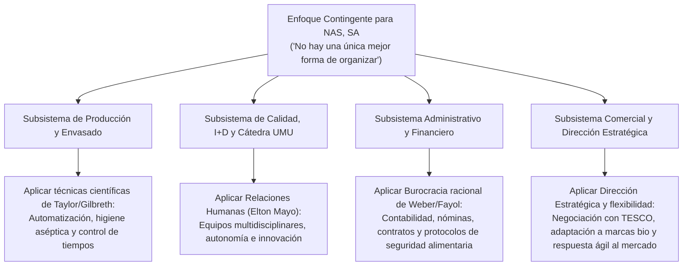

# 📝 Prácticas y Casos Resueltos — Tema 3: Evolución del Pensamiento Administrativo

- **Asignatura:** Administración de Empresas (Cód. 2345)
- **Tema:** Tema 3 — Evolución del Pensamiento Administrativo (Enfoques Clásico, Relaciones Humanas, Burocrático y Contingente)
- **Profesorado:** Jorge Monllor Domínguez y Juan José Peláez Ibarrondo (Grupo 5)
- **Documento fuente oficial:** [📄 Tema 3n Practicas ADE.pdf](./Tema%203n%20Practicas%20ADE.pdf)

---

## 🏢 Caso Práctico Oficial de Clase: "Los Modelos de Gestión de los Socios Fundadores de NAS, SA"

### 📖 Enunciado y Antecedentes
En una reunión de accionistas de **Nuevos Alimentos del Sureste, SA (NAS, SA)**, sus propietarios debaten sobre los distintos modelos organizativos que aplicaban en sus antiguas empresas antes de la fusión:

1. **María (Antiguo Laboratorio de Análisis de Calidad):**
   - El trabajo se organizaba en **equipos autónomos de 3 o 4 trabajadores**, no en empleados aislados.
   - Rotación periódica de actividades para evitar la monotonía.
   - Los propios trabajadores eran consultados para fijar el volumen mensual de análisis.
   - Responsabilidad colectiva: el informe final identificaba el código del equipo que lo había realizado.
2. **Juan y Felipe (Antigua Fábrica de Conservas Vegetales):**
   - Establecieron una **rígida jerarquía**, con deberes y derechos por escrito en un manual entregado a cada nuevo operario.
   - Existía un protocolo escrito de actuación para cada actividad; nada se dejaba a la improvisación.
   - Relaciones impersonales basadas en el cargo; puntualidad estricta y cumplimiento del 100% de los pedidos sin retrasos.
3. **Violeta y Amalio (Antigua Fábrica de Envases de Vidrio):**
   - Producción masiva a bajo coste mediante **mecanización y parcelación de tareas en sus elementos mínimos repetitivos**.
   - Ingenieros industriales aplicaban **estudios de tiempos y movimientos** cronometrando a cada obrero.
   - Control informático centralizado de inventarios y pedidos según directrices de la alta dirección.

---

## 🎯 Resolución Oficial de las 4 Cuestiones de Clase

### Cuestión 1: Identificación del enfoque administrativo seguido en cada una de las tres empresas

| Socio / Antigua Empresa | Enfoque Teórico Identificado | Autor / Escuela de Referencia | Evidencias Clave del Texto |
| :--- | :--- | :--- | :--- |
| **María** *(Laboratorio)* | **Enfoque de las Relaciones Humanas** | **Elton Mayo** (Experimentos de Hawthorne) | - Énfasis en el **grupo social de trabajo** (equipos de 3-4 personas). - Rotación de puestos para combatir la fatiga psicológica y la monotonía. - Participación de los empleados en la fijación de objetivos (liderazgo democrático). - Responsabilidad grupal compartida y motivación por reconocimiento social. |
| **Juan y Felipe** *(Conservas)* | **Enfoque Burocrático y Administración General** | **Max Weber** *(Burocracia)* y **Henri Fayol** *(Principios clásicos)* | - **Manual de normas y reglamentos escritos** para todas las tareas. - Rígida jerarquía de autoridad (cadena escalar de mando). - Eliminación total de la improvisación; rutinas y protocolos estandarizados. - Impersonalidad en las relaciones basada en puestos y no en favoritismos. |
| **Violeta y Amalio** *(Envases)* | **Escuela de la Administración Científica (Enfoque Clásico)** | **Frederick W. Taylor** *(Principios de Administración Científica)* y **Frank y Lillian Gilbreth** | - Producción masiva a bajo coste buscando la máxima **eficiencia técnica**. - Descomposición de las tareas en sus elementos mínimos (división extrema del trabajo). - **Ingenieros industriales** realizando **estudios de tiempos y movimientos (ORT)**. - Visión mecanicista del trabajador como un engranaje operativo repetitivo. |

---

### Cuestión 2: Aspectos positivos (ventajas) que se pueden alcanzar en cada empresa con el enfoque aplicado

#### A) En el Laboratorio de María (Relaciones Humanas):
1. **Alta motivación, satisfacción y compromiso:** Al sentirse escuchados y participar en la fijación de metas, los empleados desarrollan un fuerte sentido de pertenencia.
2. **Reducción del estrés y la monotonía:** La rotación de tareas estimula el aprendizaje continuo y combate el aburrimiento laboral.
3. **Calidad y autoexigencia grupal:** La responsabilidad colectiva y el código identificador de equipo generan una sana presión entre compañeros (*solidaridad grupal*) que reduce los errores en los análisis.
4. **Flexibilidad operativa:** Los miembros del equipo son polivalentes y pueden sustituirse mutuamente ante bajas imprevistas.

#### B) En la Conservera de Juan y Felipe (Burocracia / Fayol):
1. **Máxima previsibilidad y fiabilidad:** Al no dejar nada al azar, la empresa garantiza una calidad homogénea y cero retrasos en las entregas a los clientes.
2. **Claridad absoluta en las responsabilidades:** Cada trabajador sabe exactamente qué hacer, cómo hacerlo y a quién reportar, eliminando la duplicidad de funciones.
3. **Reducción de fricciones interpersonales:** El trato impersonal y regido por normas objetivas evita el favoritismo, el acoso y los conflictos de intereses.
4. **Facilidad de sustitución y formación:** Un nuevo empleado solo necesita estudiar el manual de protocolos para estar operativo en poco tiempo.

#### C) En la Fábrica de Envases de Violeta y Amalio (Administración Científica):
1. **Costes unitarios mínimos (Economías de escala):** La optimización de tiempos y movimientos y la mecanización permiten producir grandes volúmenes al coste más bajo del mercado.
2. **Rapidez y destreza técnica máxima:** Al repetir un movimiento minúsculo miles de veces, el obrero adquiere una velocidad casi perfecta.
3. **Control total de la producción y de los inventarios:** La gerencia y el sistema informático saben con precisión matemática cuánto se produce por hora y el stock exacto.
4. **Aprovechamiento de mano de obra poco cualificada:** No se requiere formación avanzada previa para puestos ultraespecializados.

---

### Cuestión 3: Consecuencias negativas (inconvenientes y disfunciones) que pueden producirse en cada empresa

#### A) En el Laboratorio de María (Relaciones Humanas):
- **Pérdida de tiempo en consensos:** Consultar a todos los trabajadores para cada decisión puede ralentizar la respuesta ante pedidos urgentes.
- **Riesgo de relajación de la productividad:** Si el grupo establece una norma informal de "ritmo cómodo", la producción puede situarse por debajo de la capacidad real (*efecto de la 4ª fase de Hawthorne*).
- **Dilución de la responsabilidad individual:** Si un análisis sale defectuoso, puede resultar difícil identificar al culpable individual dentro del equipo de 4 personas.

#### B) En la Conservera de Juan y Felipe (Burocracia):
- **Extrema rigidez y lentitud burocrática:** Ante un imprevisto que no esté contemplado en el manual, los empleados se paralizan esperando una orden superior escrita.
- **Falta de iniciativa y creatividad:** *"Reglamentitis"*; los trabajadores se limitan a cumplir la norma para no ser sancionados, sin proponer mejoras.
- **Frialdad y desmotivación por despersonalización:** Tratar a las personas como meros números o cargos desmotiva al personal con talento.

#### C) En la Fábrica de Envases de Violeta y Amalio (Administración Científica):
- **Alienación, deshumanización y fatiga psicológica:** La repetición monótona convierte al ser humano en un autómata, provocando absentismo, accidentes laborales y rotación voluntaria.
- **Conflictividad laboral:** La presión de los ingenieros con el cronómetro genera desconfianza y confrontación entre operarios y mandos intermedios.
- **Vulnerabilidad de la cadena:** Si un solo operario de la cadena de montaje se detiene o comete un fallo, toda la línea de fabricación posterior queda bloqueada.

---

### Cuestión 4: Enfoque administrativo adecuado para gestionar la nueva empresa NAS, SA en el actual clima económico

> 🏆 **Respuesta Oficial y Razonada: EL ENFOQUE DE CONTINGENCIAS (Y DE SISTEMAS)**

Para gestionar con éxito **Nuevos Alimentos del Sureste, SA (NAS, SA)** en el entorno actual (caracterizado por incertidumbre económica, alta competencia, concentración de supermercados y cambios tecnológicos rápidos), **es inviable aplicar un único modelo clásico de forma dogmática**. 

Siguiendo las aportaciones de **Burns y Stalker**, **Lawrence y Lorsch** y **Fred Luthans**, la dirección de NAS, SA debe adoptar un **Enfoque Contingente**:

#### Justificación del Enfoque Contingente por Departamentos:
1. **En la línea de producción y envasado de fábrica (Felipe):** Conviene mantener elementos de la **Administración Científica** (estandarización higiénica, protocolos asépticos de la patente y control estricto de tiempos de conservación).
2. **En el departamento de Calidad, I+D y Cátedra con la UMU (María):** Debe primar el modelo de **Relaciones Humanas**, fomentando el trabajo en equipo, la creatividad investigadora y la motivación intrínseca.
3. **En el área económico-financiera y de compras (Amalio y Juan):** Se requiere el rigor del **modelo burocrático** (contratos mercantiles por escrito, libros de cuentas, trazabilidad y cumplimiento estricto de la legislación de seguridad alimentaria).
4. **En la Dirección General y Comercial (Violeta y Antonio):** Se debe aplicar la **Dirección Estratégica** y el análisis continuo del entorno exterior (PESTEL y Porter) para anticiparse a los cambios de la gran distribución y los hábitos de los consumidores.

*En conclusión: La tarea de Violeta Vélez como Directora General consistirá en identificar las contingencias que definen cada situación concreta ("SI ocurre X") y aplicar en cada departamento la técnica organizativa que optimice la eficiencia global de la empresa ("ENTONCES aplicamos Y").*
