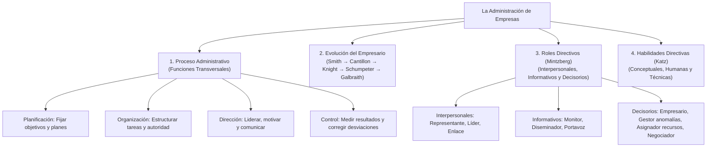
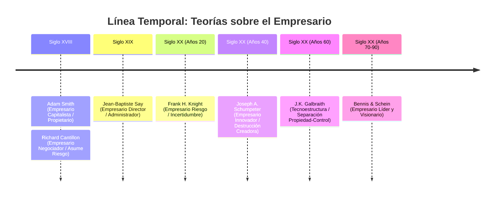
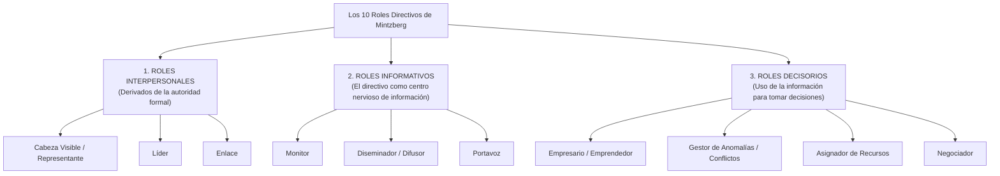
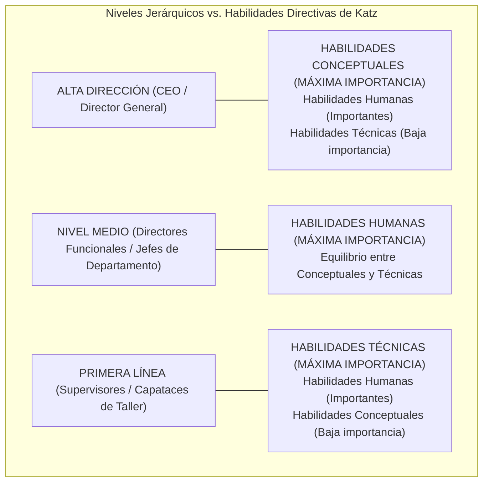

# 👔 Administración de Empresas — Tema 4: La Administración de Empresas

- **Asignatura:** Administración de Empresas (Cód. 2345)
- **Titulación:** Grado en ADE — Facultad de Economía y Empresa (Universidad de Murcia)
- **Grupo:** Grupo 5 (Turno Tarde) · **Profesorado:** Jorge Monllor Domínguez y Juan José Peláez Ibarrondo
- **Documento fuente oficial:** [📄 Tema 4n ADE.pdf](./Tema%204n%20ADE.pdf)
- **Objetivo del tema:** Analizar el proceso administrativo y sus 4 funciones, la evolución histórica de las teorías sobre el empresario, los 10 roles directivos de Henry Mintzberg y las habilidades de Robert Katz.

---

## 🧭 Mapa Conceptual de la Función Directiva

---

## 4.1. ⚙️ El Proceso de Administración y sus Funciones

> 📌 **Definición de Administración:**  
> Proceso que comprende el conjunto de actividades necesarias para asegurar el **logro de los objetivos** de la organización, coordinando los recursos disponibles y posibilitando la contribución eficaz de todos sus integrantes (Aguirre et al., 2008).

### Los Subsistemas de la Empresa desde la Perspectiva Administrativa:
1. **Subsistema Psicosocial:** Individuos y grupos en interacción, conducta, motivación, estatus y relaciones de influencia.
2. **Subsistema Técnico:** Instrumentos, maquinaria, técnicas y conocimientos para ejecutar las tareas.
3. **Subsistema de Administración:** Eje coordinador que relaciona a la empresa con su entorno, fija metas y diseña la estructura.

### Las 4 Funciones del Proceso Administrativo:

| Función | ¿Qué es? | Pregunta a la que responde | Actividades Clave |
| :--- | :--- | :---: | :--- |
| **1. Planificación** | Proceso anticipado en el que se fijan los objetivos y las líneas de acción para alcanzarlos. | *¿Qué queremos hacer y cómo?* | Diagnóstico DAFO, previsión del futuro, fijación de metas, presupuestos y planes. |
| **2. Organización** | Diseño de la estructura organizativa formal, asignación de tareas, responsabilidades y autoridad. | *¿Cómo se dividirá el trabajo y quién lo hará?* | Departamentalización, organigrama, jerarquía y asignación de recursos materiales y humanos. |
| **3. Dirección** | Proceso mediante el cual se guía, orienta y motiva a las personas para alcanzar las metas. | *¿Cómo lograr que los miembros actúen con entusiasmo?* | Liderazgo, motivación del personal, resolución de conflictos y canales de comunicación. |
| **4. Control** | Medición y supervisión continua para verificar si los resultados reales concuerdan con lo planeado. | *¿Cómo se están cumpliendo los planes y qué corregir?* | Establecimiento de estándares, medición de desviaciones y aplicación de acciones correctoras. |

> 💡 **Principio de Transversalidad (Iborra et al., 2007):**  
> Para que la administración sea eficiente, las 4 funciones no se aplican de forma aislada, sino que **atraviesan todos los subsistemas funcionales** de la empresa (Aprovisionamiento, Producción, Comercial, Finanzas y Recursos Humanos).

---

## 4.2. 👑 Evolución Histórica de la Figura del Empresario

La teoría económica ha evolucionado en su conceptualización de la figura empresarial:

### 1. Los Economistas Clásicos (Siglos XVIII – XIX):
- **Adam Smith (S. XVIII) — Empresario Capitalista:**  
  El empresario es el **dueño de los medios de producción** y el "patrón" de los trabajadores. En esta época preindustrial, la propiedad del capital y la dirección del negocio recaían siempre en la misma persona.
- **Richard Cantillon (S. XVIII) — Empresario Negociador / Emprendedor (*Entrepreneur*):**  
  Fue el primero en definir al empresario como alguien que compra factores productivos a un **precio cierto y conocido**, los transforma y los vende en el mercado a un **precio incierto y futuro**. El empresario asume el riesgo económico de la actividad.
- **Jean-Baptiste Say (S. XIX) — Empresario Director / Administrador:**  
  Distingue entre el capitalista (que aporta fondos y cobra un interés) y el empresario (que combina y coordina los factores productivos: tierra, trabajo y capital).

### 2. Los Economistas Neoclásicos (Principios del Siglo XX):
- **Alfred Marshall y J.B. Clark (S. XX) — Cuarto Factor de Producción:**  
  La organización empresarial se consagra formalmente como el cuarto factor productivo (junto a tierra, trabajo y capital). El empresario es el agente que prevé las necesidades del mercado y organiza los factores.

### 3. Aportaciones Contemporáneas (Siglo XX):
- **Frank H. Knight (Años 20) — Teoría del Empresario Riesgo:**  
  - Distingue entre **riesgo asegurable** (probabilidad conocida, como un incendio) e **incertidumbre genuina** (impredecible, como la evolución de la moda o la crisis económica).
  - El empresario es quien **asume la incertidumbre**, anticipando el pago de los factores (salarios a trabajadores, alquileres) sin saber si recuperará el dinero.
  - **El beneficio empresarial es la recompensa legítima por asumir la incertidumbre**.
- **Joseph A. Schumpeter (Años 40) — Teoría del Empresario Innovador:**  
  - El motor del desarrollo económico no es el equilibrio, sino el cambio tecnológico impulsado por el empresario innovador.
  - Concepto de **"Destrucción Creadora"**: las innovaciones rompen el equilibrio del mercado, otorgan al empresario un monopolio temporal con beneficios extraordinarios, hasta que los competidores imitan la innovación y el mercado vuelve al equilibrio.
  - **Fases del cambio tecnológico:**
    $$\text{Invención (idea)} \longrightarrow \text{Innovación (aplicación comercial)} \longrightarrow \text{Imitación (generalización)}$$
  - Solo se es empresario mientras se innova (nuevo producto, nuevo método, nuevo mercado o nueva materia prima).
- **John Kenneth Galbraith (Años 60–70) — La Tecnoestructura:**  
  - En las grandes corporaciones modernas se produce la **separación definitiva entre la propiedad (accionistas) y el control real (directivos)**.
  - El poder no lo ejerce un individuo aislado, sino la **Tecnoestructura**: un comité colegiado de profesionales especializados (abogados, ingenieros, economistas, informáticos).
  - Surge el **conflicto de objetivos**: los accionistas buscan maximizar el beneficio a corto plazo (dividendos), mientras que los directivos buscan el crecimiento de la empresa, prestigio, seguridad y remuneraciones.
- **Warren Bennis y Edgar Schein (Años 70–90) — El Empresario Líder:**  
  El directivo actual actúa como líder facilitador, fijando la visión y la cultura organizativa y orientando a las personas.

> 🏆 **Definición Sintética Actual de Empresario:**  
> *"Líder, negociador y visionario que toma las decisiones oportunas para la consecución de los objetivos de la empresa, coordinando y equilibrando los intereses de los distintos grupos de interés (stakeholders)"*.

---

## 4.3. 🎭 Los 10 Roles Directivos de Henry Mintzberg (1983)

Henry Mintzberg observó en la práctica a altos directivos y concluyó que el trabajo de un gerente no consiste en un proceso reflexivo y metódico, sino en una gran variedad de tareas breves, fragmentadas e interactivas articuladas en **10 roles agrupados en 3 categorías**:

### 1. Roles Interpersonales (Relaciones Humanas):
1. **Cabeza Visible / Representante (*Figurehead*):** Actúa como símbolo de la organización en actos protocolarios, ceremonias oficiales, cenas de gala, firmas solemnes de convenios o entrega de premios.
2. **Líder (*Leader*):** Define el clima laboral, orienta, motiva, contrata, evalúa y estimula a sus subordinados para alinear sus metas con las de la empresa.
3. **Enlace (*Liaison*):** Construye y mantiene una red de contactos horizontales y externos al margen de la línea jerárquica (con otros directivos de su nivel, proveedores, clientes estratégicos, administraciones públicas).

### 2. Roles Informativos (Gestión de Información):
4. **Monitor (*Monitor*):** Centro neurálgico que busca, recopila y filtra continuamente información interna (balances, informes de producción) y externa (noticias de competidores, ferias, cambios regulatorios).
5. **Difusor / Diseminador (*Disseminator*):** Transmite información valiosa recibida del exterior o de otros departamentos **hacia el interior de la empresa**, poniéndola a disposición de los subordinados que la necesitan.
6. **Portavoz (*Spokesperson*):** Transmite la postura y datos oficiales de la empresa **hacia el exterior** (comunicados a los medios de comunicación, informes a accionistas, ruedas de prensa, entrevistas).

### 3. Roles Decisorios (Toma de Decisiones):
7. **Empresario / Emprendedor (*Entrepreneur*):** Identifica oportunidades de negocio, inicia y diseña proyectos de mejora, autoriza inversiones innovadoras y lidera el cambio organizativo.
8. **Gestor de Anomalías / Solucionador de Problemas (*Disturbance Handler*):** Interviene cuando la empresa se enfrenta a crisis o imprevistos graves (huelgas, roturas de maquinaria, disputas entre jefes de departamento, pérdida de clientes clave).
9. **Asignador de Recursos (*Resource Allocator*):** Decide **cómo, cuánto y a quién** se distribuyen los presupuestos económicos, el tiempo de los directivos, el equipamiento y la carga de trabajo.
10. **Negociador (*Negotiator*):** Representa a la empresa en negociaciones clave con entes externos o internos donde hay recursos o intereses en juego (acuerdos con sindicatos, convenios de distribución con supermercados, créditos bancarios).

---

## 4.4. 🧠 Habilidades Directivas (Robert L. Katz, 1974)

Robert Katz demostró que la eficacia directiva no depende de rasgos innatos de personalidad, sino del dominio de **tres habilidades esenciales**, cuya importancia relativa varía según la posición que ocupe el directivo en el organigrama:

| Habilidad Directiva | Definición y Competencias | En qué nivel jerárquico es crítica |
| :--- | :--- | :---: |
| **1. Habilidad Conceptual** | Capacidad mental para contemplar la empresa como un **todo integrado**, comprender cómo interactúan sus distintas funciones entre sí y visualizar la relación de la organización con el entorno a largo plazo. Pensamiento estratégico y analítico. | **Alta Dirección** *(Director General, Consejo de Administración)*. |
| **2. Habilidad Humana** | Capacidad para trabajar con y a través de las personas, comunicarse con empatía, motivar, liderar equipos, generar confianza y resolver disputas interpersonales. | **Nivel Medio** *(Es vital en TODOS los niveles, pero constituye el núcleo del mando medio).* |
| **3. Habilidad Técnica** | Conocimiento especializado, procedimientos, herramientas y destrezas prácticas aplicadas a la ejecución de una tarea concreta (usar una máquina, contabilizar un asiento, programar). | **Supervisores de Primera Línea** *(Jefes de equipo de taller, capataces).* |

### Capacidades Directivas Esenciales en el Entorno Actual:
1. **Capacidad de Gestión del Cambio:** Liderar la transformación continua de personal, procesos y tecnología, superando la resistencia natural de las personas al cambio.
2. **Capacidad de Gestión de la Tensión y el Estrés:** Mantener el equilibrio emocional y la lucidez bajo situaciones de alta presión o plazos ajustados.
3. **Capacidad de Gestión de Conflictos:** Actuar como mediador justo para encauzar desacuerdos departamentales hacia soluciones constructivas.
