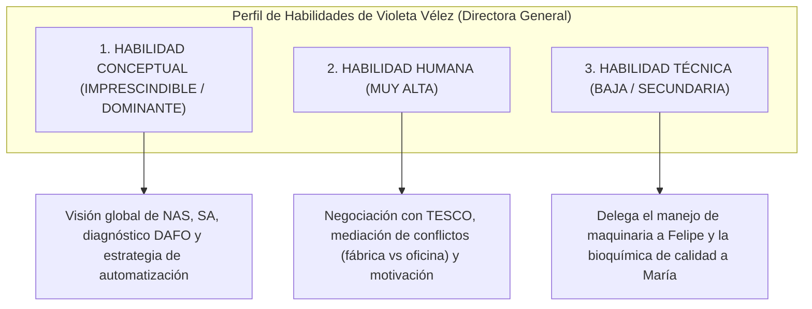

# 📝 Prácticas y Casos Resueltos — Tema 4: La Administración de Empresas

- **Asignatura:** Administración de Empresas (Cód. 2345)
- **Tema:** Tema 4 — La Función de Administración (Roles de Mintzberg y Habilidades Directivas de Katz)
- **Profesorado:** Jorge Monllor Domínguez y Juan José Peláez Ibarrondo (Grupo 5)
- **Documento fuente oficial:** [📄 Tema 4n Practicas ADE.pdf](./Tema%204n%20Practicas%20ADE.pdf)

---

## 🏢 Caso Práctico Oficial de Clase: "La Actividad Directiva de Violeta Vélez en NAS, SA"

### 📖 Enunciado y Situación de Partida
Tras un análisis estratégico del sector agroalimentario, la empresa **Nuevos Alimentos del Sureste, SA (NAS, SA)** detecta que la crisis económica y el aumento de la rivalidad están asfixiando a sus clientes tradicionales (pequeños supermercados y tiendas familiares de Murcia, Andalucía y Valencia), muchos de los cuales están cerrando. En los dos últimos años, NAS, SA no ha ganado nuevos clientes y su cifra de negocio cae.

Ante esta situación crítica, **Violeta Vélez (Directora General de NAS, SA)** decide acometer 10 actividades concretas.

---

## 🎯 Resolución Oficial de las Cuestiones de Clase

### Cuestión A: Análisis de las 10 actividades de Violeta Vélez bajo los Roles Directivos de Henry Mintzberg

| Actividad Directiva de Violeta Vélez | Rol Directivo Principal (Mintzberg) | Categoría del Rol | Justificación Teórica Detallada |
| :--- | :--- | :---: | :--- |
| **1. Va a realizar un análisis interno de la empresa y de su entorno para determinar la situación y proponer estrategias.** | **Monitor** *(y complementariamente Empresario)* | **Informativo** | Actúa como **Monitor** porque recopila, procesa y analiza información sobre el entorno exterior (competencia, crisis) y la situación interna para comprender el estado real de la organización antes de diseñar un plan. |
| **2. Viajará al Reino Unido para intentar cerrar un acuerdo con la cadena de supermercados TESCO.** | **Negociador** *(y Enlace)* | **Decisorio** | Actúa como **Negociador** porque se desplaza personalmente al extranjero para comprometer recursos de la empresa y negociar condiciones contractuales de gran envergadura (precios, volúmenes de entrega y exclusividad) con un cliente internacional estratégico. |
| **3. Subirá la asignación presupuestaria del departamento de calidad para reducir al mínimo los productos defectuosos.** | **Asignador de Recursos** | **Decisorio** | Es la máxima responsable de la distribución del capital financiero de la empresa. Decide deliberadamente detraer o incrementar fondos económicos hacia un departamento clave (gestión de la calidad) para materializar una prioridad estratégica. |
| **4. Va a emprender acciones para cambiar comportamientos de empleados (ej. conseguir mayor esfuerzo de comerciales).** | **Líder** | **Interpersonal** | Ejerce el rol de **Líder** directo sobre sus subordinados: utiliza su autoridad e influencia para motivar, guiar conductas, exigir compromiso y transformar la cultura y el rendimiento de la fuerza de ventas. |
| **5. Acudirá a la Universidad de Murcia para firmar el acuerdo negociado por el director de RRHH con el Rector.** | **Cabeza Visible / Representante** (*Figurehead*) | **Interpersonal** | Actúa como símbolo y máxima representante institucional y legal de NAS, SA. Su presencia física en el acto de la firma es de carácter protocolario y ceremonial, rubricando un convenio cuyos detalles técnicos ya habían sido cerrados previamente por el director de RRHH. |
| **6. Tras la firma, explicará las condiciones del acuerdo con la UMU al jefe de compras y a la directora de calidad.** | **Difusor / Diseminador** | **Informativo** | Actúa como **Diseminador** porque transmite información relevante procedente del exterior (las cláusulas del convenio universitario y la incorporación de becarios) **hacia el interior de la empresa**, trasladándola a los mandos intermedios afectados. |
| **7. Mediará para acabar con los conflictos entre los operarios de fábrica y el personal de oficina.** | **Gestor de Anomalías / Conflictos** (*Disturbance Handler*) | **Decisorio** | Interviene de manera activa y resolutiva ante una perturbación o crisis interna no planificada (disputas interdepartamentales entre personal de planta y administración), restaurando la armonía y el clima de trabajo. |
| **8. Automatizará todos y cada uno de los procesos productivos utilizando la última tecnología disponible.** | **Empresario / Emprendedor** (*Entrepreneur*) | **Decisorio** | Actúa como **Empresario innovador** (en el sentido de Schumpeter): promueve voluntariamente el cambio técnico y la modernización de los procesos productivos para generar ventajas competitivas en costes y productividad. |
| **9. Se reunirá con todos los accionistas y propietarios para comunicar todos los cambios y nuevos retos.** | **Portavoz** *(e Interpersonal)* | **Informativo** | Ejerce el rol de **Portavoz** oficial de la gestión: informa hacia el órgano de propiedad (los socios fundadores e inversores) sobre las decisiones estratégicas adoptadas, la marcha de la empresa y los nuevos rumbos que se avecinan. |
| **10. Visitará a los principales clientes con la finalidad de comprobar si están contentos con el trato recibido.** | **Enlace** *(y Monitor)* | **Interpersonal** | Construye y cultiva la red de relaciones externas de alto nivel con clientes prioritarios (rol de **Enlace**), recabando al mismo tiempo de primera mano impresiones sobre la calidad del servicio (rol de **Monitor**). |

---

### Cuestión B: Valoración de las Habilidades Directivas de Robert Katz en la actividad de Violeta Vélez

Como **Directora General (Alta Dirección)** de NAS, SA, el desempeño de Violeta Vélez requiere una combinación específica de las **tres habilidades de Robert Katz**:

#### 1. Habilidad Conceptual (Máxima Relevancia — Primordial para su Puesto):
- **Por qué es prioritaria:** Ocupa el vértice de la pirámide organizativa. Su labor no consiste en operar máquinas ni rellenar albaranes, sino en entender a NAS, SA como un **sistema global interdependiente** y relacionarlo con un entorno en crisis.
- **Evidencias en el caso:**
  - Realiza análisis estratégicos internos y del entorno para formular nuevos rumbos (actividad 1).
  - Identifica la necesidad de reconvertir el modelo de negocio ante la quiebra de pequeños comercios, apostando por la gran distribución internacional (TESCO, actividad 2).
  - Decide transformar la base tecnológica de toda la compañía mediante la automatización integral (actividad 8).
  - Redistribuye recursos presupuestarios estratégicamente hacia la calidad (actividad 3).

#### 2. Habilidad Humana (Muy Alta Relevancia — Eje de Coordinación):
- **Por qué es fundamental:** Un alto directivo logra resultados **a través de los demás**. La habilidad humana es indispensable en todos los niveles, pero en la dirección general permite articular equipos y resolver disputas.
- **Evidencias en el caso:**
  - Emprende acciones directas para motivar y transformar la actitud del equipo comercial (actividad 4).
  - Actúa como mediadora en la resolución de conflictos laborales entre trabajadores de fábrica y personal administrativo (actividad 7).
  - Comunica de forma transparente y persuasiva los cambios a los socios propietarios (actividad 9).
  - Mantiene empatía y diplomacia al tratar con clientes estratégicos (actividad 10) y autoridades universitarias (actividad 5).

#### 3. Habilidad Técnica (Baja Relevancia — Especialización Delegada):
- **Por qué es secundaria:** Violeta Vélez **no necesita dominar el manejo directo de las carretillas elevadoras ni conocer la formulación química del laboratorio**. Para eso cuenta con especialistas funcionales como Felipe (Jefe de Fábrica) o María (Directora de Calidad).
- **Tratamiento directivo:** Su habilidad técnica se limita a poseer el criterio suficiente para comprender los informes de sus directores y autorizar inversiones tecnológicas punteras (actividad 8). Pretender intervenir en el detalle técnico de cada tarea sería un error directivo (*micromanagement*).
