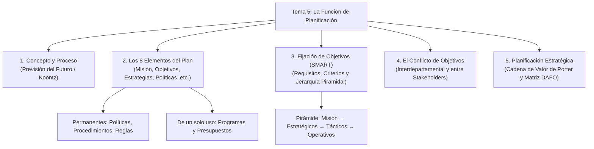
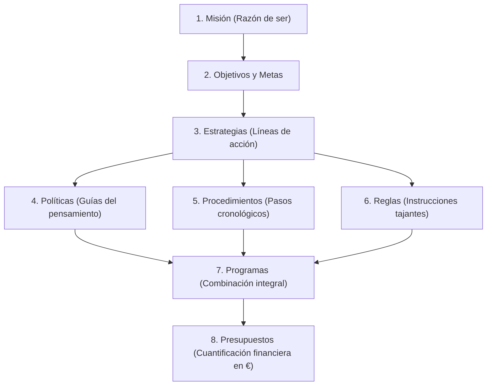
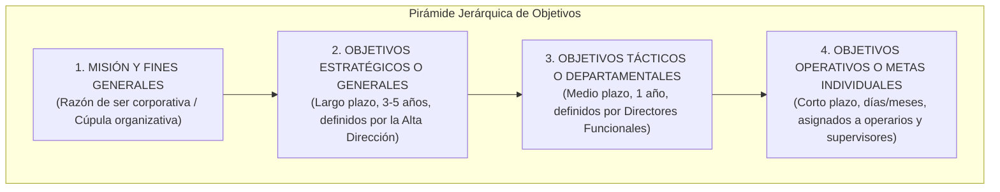
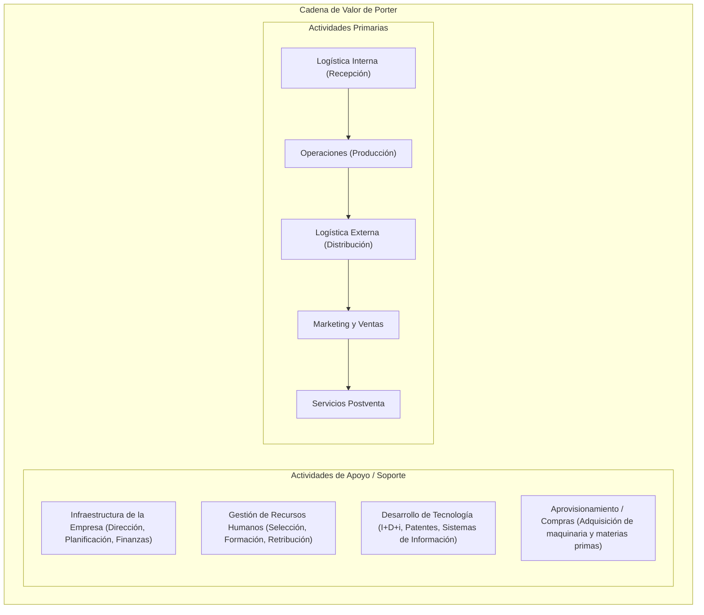

# 🎯 Administración de Empresas — Tema 5: La Función de Planificación

- **Asignatura:** Administración de Empresas (Cód. 2345)
- **Titulación:** Grado en ADE — Facultad de Economía y Empresa (Universidad de Murcia)
- **Grupo:** Grupo 5 (Turno Tarde) · **Profesorado:** Jorge Monllor Domínguez y Juan José Peláez Ibarrondo
- **Documento fuente oficial:** [📄 Tema 5n ADE.pdf](./Tema%205n%20ADE.pdf)
- **Objetivo del tema:** Dominar el concepto y proceso de planificación, los 8 elementos del plan, los estilos de Ackoff, los criterios SMART para fijar objetivos, la pirámide jerárquica, los conflictos entre objetivos y la introducción a la planificación estratégica (DAFO y Cadena de Valor).

---

## 🧭 Mapa Conceptual de la Planificación

---

## 5.1. 🗺️ Concepto y Proceso de Planificación

> 📌 **Definición de Planificación:**  
> Proceso racional y anticipado de toma de decisiones que consiste en **decidir por adelantado qué se va a hacer, cómo, cuándo y quién lo va a realizar**, tendiendo un puente entre la situación actual de la empresa y la situación futura deseada (Steiner, 1979; Aguirre et al., 1992).

- **Fayol (1916):** *"Planificar es estructurar el porvenir y confeccionar el programa de acción"*.
- **Rodrigo Illera (1994):** *"Diseñar el futuro, plasmarlo en un documento guía para los integrantes de la empresa y procurar que ese futuro se desarrolle según los intereses de la organización"*.
- **Plan:** Formalización escrita de un conjunto coordinado de acciones futuras encaminadas al logro de objetivos.

### ¿Por qué es crucial planificar?
1. **Coordina esfuerzos** y asigna racionalmente los recursos disponibles.
2. **Reduce la incertidumbre** al anticipar cambios en el entorno.
3. Permite realizar un **diagnóstico DAFO** continuo.
4. **Es la base indispensable del control:** sin planes previos, no existen estándares con los que comparar los resultados reales.

### ¿Por qué fracasa la planificación en las empresas?
- Confundir la planificación (proceso dinámico continuo) con los planes (meros documentos estáticos).
- Planificar sin objetivos definidos o con objetivos ambiguos y mal redactados.
- Falta de implicación de la alta dirección (prefieren la acción impulsiva a la reflexión estratégica).
- Falta de sistemas de información o formación técnica en los directivos.

---

### Los 8 Elementos de la Planificación (Ilustrados con el Caso Oficial de *El Pozo Alimentación*):

| Elemento | Definición Conceptual | Ejemplo Real de Clase (*El Pozo Alimentación, S.A.*) |
| :--- | :--- | :--- |
| **1. Misión** | El papel, identidad y razón de ser de la empresa en la sociedad. A qué nos dedicamos. | *"Proveer al mundo de carne y sus derivados, saludables y nutritivos"*. |
| **2. Objetivos y Metas** | Resultados concretos que se pretenden alcanzar en un horizonte temporal prefijado. | - **General:** *"Alcanzar el liderazgo de mercado mediante diferenciación e I+D"**. - **Subobjetivos:** *"Aumentar la cifra de negocios un X% en 2023"*, *"Apertura de ventas en 5 grandes cadenas de supermercados en Italia en 2023"*. |
| **3. Estrategias** | Líneas de acción maestras y asignación de recursos para alcanzar los objetivos en el entorno competitivo. | - **Estrategia defensiva:** campaña de marketing destacando la calidad. - **Estrategia ofensiva:** difusión de acciones de RSC y sostenibilidad. - **Estrategia de supervivencia/crecimiento:** diversificación en productos de pollo. |
| **4. Políticas** | Enunciados genéricos o directrices que orientan y encauzan el pensamiento y las decisiones de los directivos. | - *"Las vacantes en administración se cubrirán prioritariamente por promoción interna"*; *"Las vacantes de fábrica se cubrirán por selección externa"*; *"La financiación externa solo se gestionará con Banco Santander y CaixaBank"*. |
| **5. Procedimientos** | Secuencia cronológica y detallada de etapas para ejecutar una actividad rutinaria. | - *Procedimiento para autorizar un gasto:* Formulario de solicitud $\to$ visto bueno de jefe de departamento $\to$ verificación económica por compras $\to$ pedido. |
| **6. Reglas** | Mandatos taxativos y específicos que ordenan una acción obligatoria o prohibida, **sin margen de interpretación**. | - *"Prohibido fumar en las instalaciones"*; *"Todo operario debe ponerse bata desechable, guantes, mascarilla y calzas al entrar en planta"*; *"No desconectar nunca un terminal informático"*. |
| **7. Programas** | Conjunto complejo e integrado de objetivos, políticas, procedimientos, reglas y tiempos para un fin concreto. | - *Programa de seguridad e higiene laboral para la línea de producción de 'American Crunchy Chicken ElPozo King'*. |
| **8. Presupuestos** | Expresión cuantitativa formal y valorada en términos monetarios (euros) de los ingresos y costes de un programa. | - *Presupuesto de 150.000 € para la implantación del equipo comercial en Milán*. |

---

### Las 8 Etapas del Proceso de Planificación (Koontz y Weihrich):
1. **Tomar conciencia del problema / oportunidad:** Evaluar la situación interna y externa.
2. **Establecimiento de objetivos:** Determinar qué se quiere lograr y en qué plazo.
3. **Análisis de contingencias y premisas:** Prever el comportamiento de variables críticas.
4. **Desarrollo de líneas de actuación alternativas:** Diseñar diversos caminos posibles.
5. **Evaluación de alternativas:** Ponderar pros, contras, costes y riesgos de cada opción.
6. **Selección de la mejor alternativa:** Decidir la estrategia a implantar.
7. **Formulación de planes derivados / de apoyo:** Planes operativos de compras, personal, finanzas.
8. **Presupuestación:** Asignación de recursos económicos y calendarios definitivos.

---

### Los 4 Estilos de Planificación según Russell Ackoff (1990):

| Estilo de Planificación | Orientación Temporal | Cómo actúa la Dirección | Metáfora |
| :--- | :---: | :--- | :--- |
| **1. Reactiva** | **Pasado** | Intenta deshacer los cambios recientes y regresar a la situación anterior. Cree que los tiempos pasados fueron mejores. | *Planificar mirando por el espejo retrovisor.* |
| **2. Inactiva** | **Presente** | Se esfuerza por mantener el *statu quo*. Evita los cambios a toda costa y solo actúa para neutralizar amenazas inmediatas. | *Dejarse llevar por la corriente.* |
| **3. Preactiva** | **Futuro (Adaptativo)** | Intenta pronosticar las tendencias futuras del mercado y se prepara con antelación para aprovecharlas. | *Preparar el paraguas porque va a llover.* |
| **4. Interactiva / Proactiva** | **Futuro (Creador)** | Considera que el futuro no es algo predeterminado, sino que **se puede moldear y crear** mediante las decisiones de la empresa. | *Diseñar el futuro deseado y hacer que ocurra.* |

---

## 5.2. 🎯 Fijación de Objetivos: Requisitos y Criterios SMART

> 📌 **Definición de Objetivo (Zerilli, 1992):**  
> *"Resultados preestablecidos, más o menos alejados en el tiempo, que pretendemos alcanzar mediante nuestra propia acción deliberada"*.

### El Acrónimo SMART para Formular Objetivos de Calidad:
- **S (Specific - Específico):** Debe estar redactado con total claridad, definiendo con exactitud qué se va a conseguir, sin ambigüedades.
- **M (Measurable - Medible):** Debe cuantificarse mediante una cifra monetaria (€), unidades físicas o porcentaje (%).
- **A (Attainable - Alcanzable):** Debe ser realista y factible teniendo en cuenta los recursos y la situación del mercado.
- **R (Relevant - Relevante):** Debe ser coherente con la misión global de la empresa y aportar valor estratégico.
- **T (Timely / Time-bound - Temporalizado):** Debe tener asignado un plazo o fecha límite de ejecución.

### Requisitos Básicos de los Objetivos (Eduardo Bueno Campos, 2001):
1. **Realistas:** Basados en las capacidades reales de la empresa.
2. **Coordinados y compatibles:** Evitar que un objetivo choque con otro.
3. **Claros y exhaustivos:** Comprensibles para todos los implicados.
4. **Medibles:** Formulados con métricas exactas.
5. **Estables pero flexibles:** Que garanticen continuidad pero admitan ajustes ante cambios imprevistos.
6. **Comunicados formalmente** a los responsables de cumplirlos.
7. **Número reducido:** Centrarse en las prioridades críticas y descartar lo superfluo.

---

### La Pirámide Jerárquica de Objetivos (Koontz & Weihrich / Aguirre et al.):

- A medida que **descendemos** en la pirámide: aumenta el **grado de concreción**, disminuye el horizonte temporal y los objetivos se desagregan en subobjetivos específicos asignados a unidades inferiores.

---

## 5.3. ⚡ El Conflicto de Objetivos

Una organización moderna es una coalición de intereses múltiples; por tanto, los objetivos entran en conflicto con frecuencia:

### 1. Conflictos Interdepartamentales (entre Subsistemas):
- **Aprovisionamiento vs. Finanzas:** Compras desea adquirir materias primas en grandes volúmenes para obtener descuentos (*rappels*), pero Finanzas exige stocks mínimos para no inmovilizar capital.
- **Producción vs. Comercial:** Producción prefiere fabricar grandes lotes de productos estandarizados para abaratar costes, mientras que Comercial exige variedad, personalización y entregas inmediatas.
- **Calidad vs. Costes:** Calidad exige inspecciones exhaustivas y materias primas caras, mientras que Dirección Financiera busca abaratar costes para elevar la rentabilidad a corto plazo.

### 2. Conflictos entre Grupos Sociales (Stakeholders):
- **Accionistas vs. Directivos:** Los accionistas buscan maximizar el beneficio a corto plazo y repartir dividendos; los directivos prefieren reinvertir en crecimiento, I+D y proyectos que aumenten su prestigio y remuneración.
- **Empresa vs. Trabajadores:** La empresa busca flexibilidad y productividad con costes salariales contenidos; los empleados reclaman subidas salariales, estabilidad y reducción de horas extra.
- **Empresa vs. Comunidad / Clientes:** Búsqueda de beneficios frente a exigencias ecologistas de eliminación de vertidos y precios asequibles.

---

## 5.4. 📉 Críticas al Objetivo Tradicional del "Máximo Beneficio"

La teoría clásica asumía que el único fin de la empresa es maximizar el beneficio monetario. La teoría de la organización moderna critica este supuesto (Aguirre et al., 2008):
1. **Noción de beneficio imprecisa y relativa:** El beneficio depende de criterios contables arbitrarios (métodos de amortización, valoración de existencias FIFO/PMP, provisiones).
2. **Racionalidad Limitada y Beneficio Satisfactorio (Herbert Simon):** Los directivos no tienen información perfecta del futuro; por ello, no buscan el óptimo matemático absoluto, sino un **nivel de beneficio satisfactorio** que garantice la supervivencia, el crecimiento y la paz con los accionistas.
3. **Pluralidad de metas:** Las empresas persiguen simultáneamente objetivos de cuota de mercado, prestigio, responsabilidad social (ODS) y sostenibilidad ambiental.

---

## 5.5. 🔍 Introducción a la Planificación Estratégica: DAFO y Cadena de Valor

### 1. La Cadena de Valor de Michael Porter (1985) — Análisis Interno
Descompone la empresa en sus actividades estratégicas para identificar fuentes de ventaja competitiva en costes o en diferenciación:

### 2. La Matriz DAFO (Análisis Externo e Interno) y Estrategias Derivadas:

| | **Oportunidades (Entorno)** | **Amenazas (Entorno)** |
| :---: | :--- | :--- |
| **Fortalezas (Internas)** | 🚀 **ESTRATEGIA OFENSIVA (Max F, Max O):** Aprovechar las fortalezas internas para explotar las oportunidades del mercado (crecimiento, entrada en nuevos países). | 🛡️ **ESTRATEGIA DEFENSIVA (Max F, Min A):** Usar las fortalezas de la empresa para neutralizar o protegerse de las amenazas de la competencia. |
| **Debilidades (Internas)** | 🔄 **ESTRATEGIA DE REORIENTACIÓN (Min D, Max O):** Corregir debilidades internas para poder aprovechar una oportunidad atractiva del entorno. | ⚠️ **ESTRATEGIA DE SUPERVIVENCIA (Min D, Min A):** Minimizar debilidades y eludir amenazas (reducción de costes, desinversión, alianzas de rescate). |
