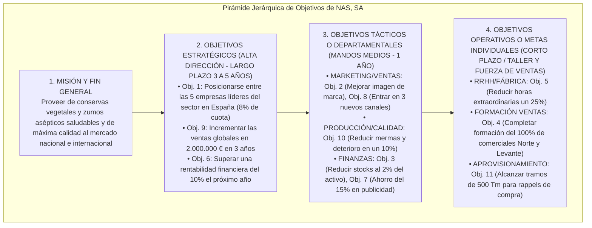
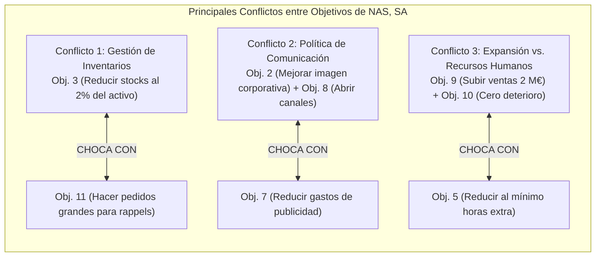

# 📝 Prácticas y Casos Resueltos — Tema 5: La Función de Planificación

- **Asignatura:** Administración de Empresas (Cód. 2345)
- **Tema:** Tema 5 — La Función de Planificación (Criterios SMART, Pirámide de Objetivos y Conflictos)
- **Profesorado:** Jorge Monllor Domínguez y Juan José Peláez Ibarrondo (Grupo 5)
- **Documento fuente oficial:** [📄 Tema 5n Practicas ADE.pdf](./Tema%205n%20Practicas%20ADE.pdf)

---

## 🏢 Caso Práctico Oficial de Clase: "Los 11 Objetivos de Violeta Vélez en NAS, SA"

### 📖 Enunciado Oficial
La Directora General de la Empresa **Nuevos Alimentos del Sureste, SA (NAS, SA)**, Violeta Vélez, ha formulado los siguientes 11 objetivos para la compañía:
1. Colocar a la empresa entre las más importantes del sector.
2. Mejorar la imagen corporativa de la empresa.
3. Reducir los stocks de la empresa en los próximos tres años, hasta que representen un 2% del volumen de activo.
4. Continuar con el plan de formación de técnicas de venta sobre aquellos vendedores de las delegaciones Norte y Levante que no lo han terminado durante el presente año.
5. Conseguir que los obreros de fábrica hagan el menor número posible de horas extra.
6. Conseguir que la rentabilidad de la empresa supere el 10% el próximo año.
7. Reducir los gastos de publicidad en los distintos medios de comunicación.
8. Distribuir los productos por tantos canales como sea posible.
9. Incrementar las ventas globales de la empresa en 2.000.000 € en el plazo de tres años.
10. Reducir en un 10% el deterioro de los alimentos en el próximo año.
11. Hacer los pedidos de reposición de género en cantidades importantes para beneficiarnos de los posibles *rappels* por compras.

---

## 🎯 Resolución Oficial de las 3 Cuestiones de Clase

### Cuestión A: Evaluación crítica de los objetivos y Reformulación bajo Criterios SMART

Para que un objetivo sea operativo y sirva de guía para la toma de decisiones y el control, debe cumplir los **criterios SMART** (*Specific, Measurable, Attainable, Relevant, Timely*) y los requisitos de Eduardo Bueno (claros, cuantitativos y temporalizados):

| Nº | Objetivo Original de Violeta | ¿Está bien formulado? | Deficiencias Detectadas | Propuesta de Reformulación SMART |
| :---: | :--- | :---: | :--- | :--- |
| **1** | Colocar a la empresa entre las más importantes del sector. | ❌ **MAL** | Excesivamente vago e impreciso. No cuantifica qué significa "ser importante" (¿cuota de mercado, facturación, volumen?) ni fija un plazo temporal (*no es Measurable ni Timely*). | *"Situar a NAS, SA entre las 5 empresas con mayor cuota de mercado en conservas vegetales en España, alcanzando un 8% de cuota en un plazo de 4 años"*. |
| **2** | Mejorar la imagen corporativa de la empresa. | ❌ **MAL** | Es una declaración de intenciones o deseo cualitativo. No define el indicador de imagen ni el horizonte temporal (*no es Measurable ni Timely*). | *"Incrementar la notoriedad de marca espontánea del 15% al 30% y obtener una valoración de satisfacción media de 8,5/10 en encuestas de clientes durante el próximo ejercicio"*. |
| **3** | Reducir los stocks en los próximos tres años hasta que representen un 2% del activo. | ✅ **BIEN** | Es **específico** (stocks), **medible** (2% del activo), **alcanzable**, **relevante** (eficiencia financiera) y **temporalizado** (en 3 años). Cumple SMART. | *(Válido tal como está redactado)*: *"Reducir el volumen de existencias en almacén hasta representar el 2% del activo total en el plazo de 3 años"*. |
| **4** | Continuar con el plan de formación en ventas para los vendedores de Norte y Levante que no lo han terminado. | ⚠️ **REGULAR** | Es una tarea o acción operativa más que un objetivo cuantitativo de resultado. Le falta fecha límite exacta y porcentaje de finalización. | *"Completar al 100% el programa de capacitación en técnicas de venta para los 12 comerciales pendientes de las zonas Norte y Levante antes del 31 de diciembre del año en curso"*. |
| **5** | Conseguir que los obreros de fábrica hagan el menor número posible de horas extra. | ❌ **MAL** | "El menor número posible" es una fórmula ambigua y subjetiva. No cuantifica el límite de horas ni fija fecha (*no es Measurable*). | *"Reducir las horas extraordinarias del personal de fábrica en un 25% respecto al año anterior durante los próximos 12 meses"*. |
| **6** | Conseguir que la rentabilidad de la empresa supere el 10% el próximo año. | ✅ **BIEN** | Es **específico**, **cuantitativo** ($>10\%$), **relevante** y **temporalizado** (el próximo año). *(Conviene solo matizar si es rentabilidad económica ROA o financiera ROE)*. | *"Alcanzar una rentabilidad financiera (ROE) superior al 10% al cierre del ejercicio económico de 2027"*. |
| **7** | Reducir los gastos de publicidad en los distintos medios de comunicación. | ❌ **MAL** | No indica en qué porcentaje ni en cuánto dinero (€) se recortará la partida, ni en qué plazo (*no es Measurable ni Timely*). | *"Reducir el gasto publicitario en medios convencionales en un 15% (un ahorro de 30.000 €) durante el próximo año presupuestario"*. |
| **8** | Distribuir los productos por tantos canales como sea posible. | ❌ **MAL** | Formulación utópica y genérica. "Tantos como sea posible" no orienta la estrategia comercial ni especifica los canales (*no es Specific ni Measurable*). | *"Incorporar 3 nuevos canales de distribución (plataforma de e-commerce propia, canal HORECA y acuerdos con 2 cadenas de supermercados regionales) en los próximos 18 meses"*. |
| **9** | Incrementar las ventas globales de la empresa en 2.000.000 € en el plazo de tres años. | ✅ **BIEN** | **Excelente formulación:** específico, perfectamente cuantificado en euros ($2.000.000$ €) y con plazo definido (3 años). Cumple SMART al 100%. | *(Válido tal como está redactado)*: *"Incrementar la cifra de ventas consolidada en 2.000.000 € en el horizonte temporal de tres años"*. |
| **10** | Reducir en un 10% el deterioro de los alimentos en el próximo año. | ✅ **BIEN** | **Específico** (mermas/deterioro), **medible** ($-10\%$), **alcanzable**, **relevante** para una conservera y **temporalizado** (en un año). Cumple SMART. | *(Válido tal como está redactado)*: *"Disminuir las mermas por deterioro de materias primas y producto elaborado en un 10% durante el próximo año"*. |
| **11** | Hacer los pedidos de reposición de género en cantidades importantes para beneficiarnos de los *rappels*. | ❌ **MAL** | Es una política de compras o directriz de gestión, no un objetivo cuantificado. "Cantidades importantes" es subjetivo (*no es Measurable ni Timely*). | *"Alcanzar el tramo de compras de 500 toneladas anuales con los proveedores de envases y alcachofas para conseguir un descuento por volumen (rappel) mínimo del 8% durante este año"*. |

---

### Cuestión B: Elaboración de la Pirámide Jerárquica de Objetivos

Estructuramos los objetivos reformulados de Violeta en los niveles de la pirámide organizativa (Koontz & Weihrich / Aguirre et al.):

---

### Cuestión C: Identificación de los Conflictos entre Objetivos

En la lista de objetivos planteada por Violeta existen **graves contradicciones e incompatibilidades mutuas** que deben ser gestionadas y equilibradas por la Dirección General:

#### 1. Conflicto Clásico de Almacén: Objetivo 3 vs. Objetivo 11
- **El choque:** El **Objetivo 3** exige reducir drásticamente los stocks hasta un mínimo del $2\%$ del activo (para no inmovilizar dinero y ahorrar costes de almacenamiento), mientras que el **Objetivo 11** promueve comprar en volúmenes muy grandes para beneficiarse de los descuentos por volumen (*rappels*).
- **Resolución directiva:** Se debe calcular el **Lote Económico de Pedido (Modelo Wilson)** que equilibre el ahorro obtenido por el *rappel* con el coste financiero de mantener el inventario en las cámaras frigoríficas.

#### 2. Conflicto Comercial y de Imagen: Objetivo 2 y Objetivo 8 vs. Objetivo 7
- **El choque:** Los **Objetivos 2 y 8** pretenden mejorar la imagen corporativa de la marca y expandir la distribución por tantos canales como sea posible (lo que requiere fuertes campañas de publicidad, promoción en el punto de venta y marketing digital), mientras que el **Objetivo 7** ordena recortar el gasto en publicidad.
- **Resolución directiva:** Reorientar el presupuesto hacia canales de alta eficiencia y bajo coste (marketing digital enfocado y redes) en lugar de recortes indiscriminados que dañen la notoriedad de marca.

#### 3. Conflicto Operativo y Laboral: Objetivo 9 vs. Objetivo 5
- **El choque:** El **Objetivo 9** fija un ambicioso crecimiento de ventas de $2.000.000$ € (lo que obligará a intensificar el ritmo de producción en campaña de frutas y hortalizas), mientras que el **Objetivo 5** exige minimizar las horas extraordinarias de los obreros.
- **Resolución directiva:** Si no se autorizan horas extra, NAS, SA deberá aumentar la contratación de trabajadores temporales en campaña o acelerar la automatización de la maquinaria de envasado para elevar la productividad por hora ordinaria.

#### 4. Conflicto entre Corto Plazo y Largo Plazo: Objetivo 6 vs. Objetivos 4 y 10
- **El choque:** Exigir una rentabilidad inmediata superior al $10\%$ el próximo año (**Objetivo 6**) puede tentar a la dirección a recortar en planes de formación de vendedores (**Objetivo 4**) o en controles preventivos de calidad de alimentos (**Objetivo 10**), hipotecando la sostenibilidad y reputación de la empresa a medio y largo plazo.
