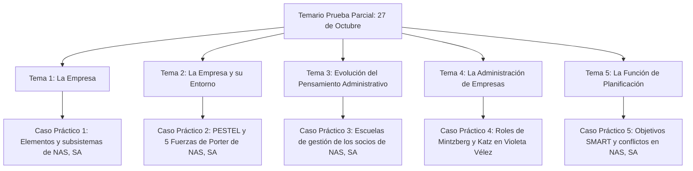

# 🏢 Administración de Empresas

- **Titulación:** (231) Grado en Administración y Dirección de Empresas (Plan 2009)
- **Centro:** Facultad de Economía y Empresa — Universidad de Murcia (Campus de Espinardo)
- **Código de Asignatura:** `2345`
- **Créditos:** 6 ECTS · **Tipo:** Formación Básica
- **Cuatrimestre:** 1.er Cuatrimestre (C1) · **Grupo:** Grupo 5 (Turno Tarde)
- **Profesorado:**
  - **Monllor Domínguez, Jorge** ([jmonllor@um.es](mailto:jmonllor@um.es)) *(Coordinador)*
  - **Peláez Ibarrondo, Juan José** ([jpelaez@um.es](mailto:jpelaez@um.es))
- **Departamento:** Organización de Empresas y Finanzas

---

## 🚨 FECHAS CLAVE DE EVALUACIÓN CONTINUA (C1)

> [!IMPORTANT]
> ### 📅 PRUEBA PARCIAL EVALUABLE: Martes, 27 de octubre de 2026 (18:30 – 20:30 h)
> - **Lugar:** Aula A412 (franja de clase teórica)
> - **Materia objeto de examen:** **TEMAS DEL 1 AL 5** completos.
>   - **Tema 1:** La Empresa (Concepto, subsistemas, tipologías y la empresa como sistema abierto).
>   - **Tema 2:** La Empresa y su Entorno (Análisis PESTEL y las 5 Fuerzas de Porter).
>   - **Tema 3:** Evolución del Pensamiento Administrativo (Taylor, Fayol, Mayo, Weber y Contingencias).
>   - **Tema 4:** La Administración de Empresas (Proceso administrativo, figuras del empresario, 10 roles de Mintzberg y habilidades de Katz).
>   - **Tema 5:** La Función de Planificación (Proceso de Koontz, 8 elementos del plan, criterios SMART, pirámide de objetivos, conflictos y DAFO).
> - **Caso transversal de examen:** Prácticas aplicadas sobre el caso oficial de la empresa **Nuevos Alimentos del Sureste, SA (NAS, SA)**.
> - **Actividad Obligatoria vinculada:** **Jueves, 22 de octubre de 2026 (12:30 – 14:30 h)** en el **Salón de Actos** — *Mesa Redonda: "Marketing digital. Más allá del clic."* Ponentes: Encar Gallardo (Playroom), Pedro Javier Gallego (Connectif) y Teresa Moreno (PcComponentes). 📄 **[Ver Memoria Académica Oficial](./Actividades/Mesa_Redonda_Marketing_Digital_2026.md)**.
> - **Examen Final Ordinario:** **Jueves, 14 de enero de 2027 (09:00 – 12:00 h)**. Consulta el [Calendario Oficial](../CALENDARIO_EXAMENES_OFICIALES_2026_2027.md).

---

## 🕒 Horarios y Aulas de Clase (Grupo 5)

| Día | Franja Horaria | Modalidad | Subgrupo | Aula |
| :---: | :---: | :---: | :---: | :---: |
| **Martes** | 18:30 – 20:30 | Teoría (Grupo Completo) | Grupo 5 | **Aula A412** |
| **Lunes** | 16:00 – 17:30 | Prácticas (Desdoble) | **Grupo B** | **Aula A411P** |
| **Lunes** | 17:30 – 19:00 | Prácticas (Desdoble) | **Grupo A** | **Aula A412** |
| **Viernes** | *(Rotativo s/ Cronograma)* | Sesiones adicionales (+3h) | Grupo 5 | **Aula A412** |

> ⏱️ *Recuerda la regla de cortesía de los 10 minutos: las clases comienzan a y 10.*  
> 📅 *Consulta el [Cronograma Semanal Grupal](../CRONOGRAMA_SEMANAL_GRUPO_5.md) y el [Horario completo](../README.md#🕒-horario-semanal--grupo-5-turno-tarde--1er-cuatrimestre).*

---

## 📚 Estructura por Bloques Temáticos (Prueba Parcial: Temas 1 al 5)

Cada tema cuenta con su manual teórico estructurado, sus diapositivas oficiales en PDF y el cuaderno de prácticas resuelto paso a paso sobre el caso de la empresa **NAS, SA**:

---

### 📁 [1 - La Empresa](./1%20-%20La%20Empresa)
- **Apuntes Teóricos:** 📄 **[Tema 1: La Empresa](./1%20-%20La%20Empresa/Apuntes/Tema_01_La_Empresa.md)** — Concepto económico y administrativo, evolución histórica, elementos empresariales y capital intelectual, tipologías y clasificación de empresas según la UE, formas jurídicas y la empresa como sistema socio-técnico abierto.
- **Diapositivas Oficiales:** 📑 **[PDF Diapositivas Tema 1](./1%20-%20La%20Empresa/Apuntes/ADMINISTRACION_DE_EMPRESA_Tema%201n%20ADE.pdf)**
- **Prácticas Oficiales Resueltas:** 📝 **[Prácticas Resueltas Tema 1](./1%20-%20La%20Empresa/Pr%C3%A1cticas/README.md)** — Caso práctico oficial: Juan Juárez y la fundación de Nuevos Alimentos del Sureste, SA (NAS, SA), clasificación socioeconómica, elementos, subsistemas e inputs/outputs.
- **Boletín de Prácticas:** 📑 **[PDF Prácticas Tema 1](./1%20-%20La%20Empresa/Pr%C3%A1cticas/Tema%201n%20Practicas%20ADE.pdf)**

---

### 📁 [2 - La Empresa y su Entorno](./2%20-%20La%20Empresa%20y%20su%20Entorno)
- **Apuntes Teóricos:** 📄 **[Tema 2: La Empresa y su Entorno](./2%20-%20La%20Empresa%20y%20su%20Entorno/Apuntes/Tema_02_La_Empresa_y_su_Entorno.md)** — Entorno general y específico, dimensiones del entorno (dinamismo, complejidad, incertidumbre), modelo PESTEL por niveles territoriales, las 5 Fuerzas Competitivas de Michael Porter y Responsabilidad Social Corporativa (RSC / ODS).
- **Diapositivas Oficiales:** 📑 **[PDF Diapositivas Tema 2](./2%20-%20La%20Empresa%20y%20su%20Entorno/Apuntes/ADMINISTARCION_EMPRESA_TEMA_2_ADE.pdf)**
- **Prácticas Oficiales Resueltas:** 📝 **[Prácticas Resueltas Tema 2](./2%20-%20La%20Empresa%20y%20su%20Entorno/Pr%C3%A1cticas/README.md)** — Análisis PESTEL completo del sector de conservas y zumos en España y Murcia, y evaluación de las 5 Fuerzas de Porter para NAS, SA.
- **Boletín de Prácticas:** 📑 **[PDF Prácticas Tema 2](./2%20-%20La%20Empresa%20y%20su%20Entorno/Pr%C3%A1cticas/Tema%202n%20Practicas%20ADE.pdf)**

---

### 📁 [3 - Evolución del Pensamiento Administrativo](./3%20-%20Evoluci%C3%B3n%20del%20Pensamiento%20Administrativo)
- **Apuntes Teóricos:** 📄 **[Tema 3: Evolución del Pensamiento Administrativo](./3%20-%20Evoluci%C3%B3n%20del%20Pensamiento%20Administrativo/Apuntes/Tema_03_Evolucion_del_Pensamiento_Administrativo.md)** — Etapas históricas, Enfoque clásico (Taylor / Administración Científica y ORT vs. Fayol / Administración General, 6 funciones y 14 principios), Enfoque de las Relaciones Humanas (Elton Mayo y las 4 fases de Hawthorne), Enfoque Burocrático (Max Weber: características, ventajas y disfunciones) y Enfoque de Contingencias (Burns, Stalker y Luthans).
- **Diapositivas Oficiales:** 📑 **[PDF Diapositivas Tema 3](./3%20-%20Evoluci%C3%B3n%20del%20Pensamiento%20Administrativo/Apuntes/Tema%203n%20ADE.pdf)**
- **Prácticas Oficiales Resueltas:** 📝 **[Prácticas Resueltas Tema 3](./3%20-%20Evoluci%C3%B3n%20del%20Pensamiento%20Administrativo/Pr%C3%A1cticas/README.md)** — Debate de los socios de NAS, SA: el laboratorio de María (Mayo), las conservas de Juan y Felipe (Burocracia/Fayol), los envases de Violeta y Amalio (Taylor), pros y contras, y el enfoque contingente para la empresa fusionada.
- **Boletín de Prácticas:** 📑 **[PDF Prácticas Tema 3](./3%20-%20Evoluci%C3%B3n%20del%20Pensamiento%20Administrativo/Pr%C3%A1cticas/Tema%203n%20Practicas%20ADE.pdf)**

---

### 📁 [4 - La Administración de Empresas](./4%20-%20La%20Administraci%C3%B3n%20de%20Empresas)
- **Apuntes Teóricos:** 📄 **[Tema 4: La Administración de Empresas](./4%20-%20La%20Administraci%C3%B3n%20de%20Empresas/Apuntes/Tema_04_La_Administracion_de_Empresas.md)** — El proceso administrativo y sus 4 funciones transversales (Planificación, Organización, Dirección y Control), evolución de la figura del empresario (Smith, Cantillon, Say, Marshall, Knight, Schumpeter, Galbraith, Bennis y Schein), los 10 roles directivos de Henry Mintzberg y las 3 habilidades directivas de Robert Katz.
- **Diapositivas Oficiales:** 📑 **[PDF Diapositivas Tema 4](./4%20-%20La%20Administraci%C3%B3n%20de%20Empresas/Apuntes/Tema%204n%20ADE.pdf)**
- **Prácticas Oficiales Resueltas:** 📝 **[Prácticas Resueltas Tema 4](./4%20-%20La%20Administraci%C3%B3n%20de%20Empresas/Pr%C3%A1cticas/README.md)** — Análisis de las 10 actividades directivas de Violeta Vélez en NAS, SA bajo los roles de Mintzberg y valoración del peso de las habilidades conceptuales, humanas y técnicas en la Dirección General.
- **Boletín de Prácticas:** 📑 **[PDF Prácticas Tema 4](./4%20-%20La%20Administraci%C3%B3n%20de%20Empresas/Pr%C3%A1cticas/Tema%204n%20Practicas%20ADE.pdf)**

---

### 📁 [5 - La Función de Planificación](./5%20-%20La%20Funci%C3%B3n%20de%20Planificaci%C3%B3n)
- **Apuntes Teóricos:** 📄 **[Tema 5: La Función de Planificación](./5%20-%20La%20Funci%C3%B3n%20de%20Planificaci%C3%B3n/Apuntes/Tema_05_La_Funcion_de_Planificacion.md)** — Concepto de planificación y etapas de Koontz, los 8 elementos del plan (Misión, Objetivos, Estrategias, Políticas, Procedimientos, Reglas, Programas y Presupuestos aplicados a *El Pozo*), estilos de Ackoff, criterios SMART y requisitos de objetivos de Bueno, jerarquía piramidal de metas, conflicto de objetivos, críticas al beneficio máximo y DAFO / Cadena de Valor de Porter.
- **Diapositivas Oficiales:** 📑 **[PDF Diapositivas Tema 5](./5%20-%20La%20Funci%C3%B3n%20de%20Planificaci%C3%B3n/Apuntes/Tema%205n%20ADE.pdf)**
- **Prácticas Oficiales Resueltas:** 📝 **[Prácticas Resueltas Tema 5](./5%20-%20La%20Funci%C3%B3n%20de%20Planificaci%C3%B3n/Pr%C3%A1cticas/README.md)** — Evaluación crítica de los 11 objetivos de Violeta Vélez en NAS, SA, reformulación con criterios SMART, construcción de la pirámide de objetivos y análisis razonado de conflictos (stocks vs. rappels, publicidad vs. imagen, ventas vs. horas extra).
- **Boletín de Prácticas:** 📑 **[PDF Prácticas Tema 5](./5%20-%20La%20Funci%C3%B3n%20de%20Planificaci%C3%B3n/Pr%C3%A1cticas/Tema%205n%20Practicas%20ADE.pdf)**

---

## 🎯 Plan de Estudio Recomendado para el Parcial (12 Días: del 15 al 27 de Octubre)

| Periodo | Objetivo de Estudio | Tareas Concretas |
| :--- | :--- | :--- |
| **Días 1 y 2 (16 - 17 Oct)** | **Tema 1:** La Empresa | Repasar el concepto de empresa como sistema y las clasificaciones con el caso de [Juan Juárez y NAS, SA](./1%20-%20La%20Empresa/Pr%C3%A1cticas/README.md). |
| **Días 3 y 4 (18 - 19 Oct)** | **Tema 2:** Entorno | Dominar el cuadro [PESTEL y las 5 Fuerzas de Porter](./2%20-%20La%20Empresa%20y%20su%20Entorno/Pr%C3%A1cticas/README.md) del sector conservero. |
| **Días 5 y 6 (20 - 21 Oct)** | **Tema 3:** Pensamiento Administrativo | Memorizar las diferencias entre Taylor, Fayol, Mayo, Weber y la síntesis del [Enfoque Contingente](./3%20-%20Evoluci%C3%B3n%20del%20Pensamiento%20Administrativo/Pr%C3%A1cticas/README.md). |
| **Día 7 (22 Oct · 12:30h)** | **Mesa Redonda:** Marketing Digital | Asistencia obligatoria en el Salón de Actos (conecta directamente con los Temas 2 y 5). |
| **Días 8 y 9 (23 - 24 Oct)** | **Tema 4:** Roles y Habilidades | Clavar los [10 roles de Mintzberg y las 3 habilidades de Katz](./4%20-%20La%20Administraci%C3%B3n%20de%20Empresas/Pr%C3%A1cticas/README.md) con las 10 actividades de Violeta. |
| **Día 10 (25 Oct)** | **Tema 5:** Planificación y Objetivos | Practicar la reformulación [SMART de objetivos y la pirámide jerárquica](./5%20-%20La%20Funci%C3%B3n%20de%20Planificaci%C3%B3n/Pr%C3%A1cticas/README.md). |
| **Días 11 y 12 (26 - 27 Oct)** | **Simulacro y Repaso Global** | Repaso de esquemas y conexión transversal entre temas antes del examen (18:30 h en el Aula A412). |

---

## 🔗 Recursos de Interés

- [Aula Virtual UM (Sakai)](https://aulavirtual.um.es/)
- [Guía Docente Oficial UM — Cód. 2345](https://www.um.es/web/estudios/grados/ade/plan-guias)
- [Portal IPYME — Creación y Estadísticas de Empresas](https://plataformapyme.es/)
