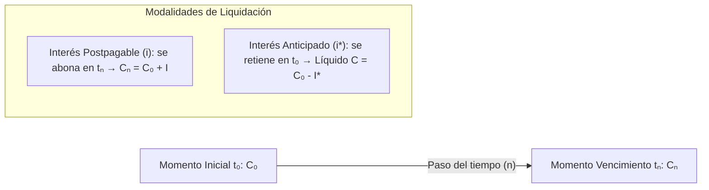
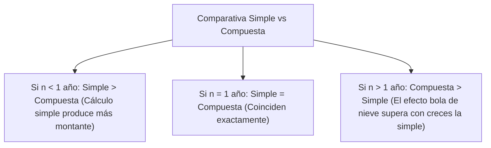
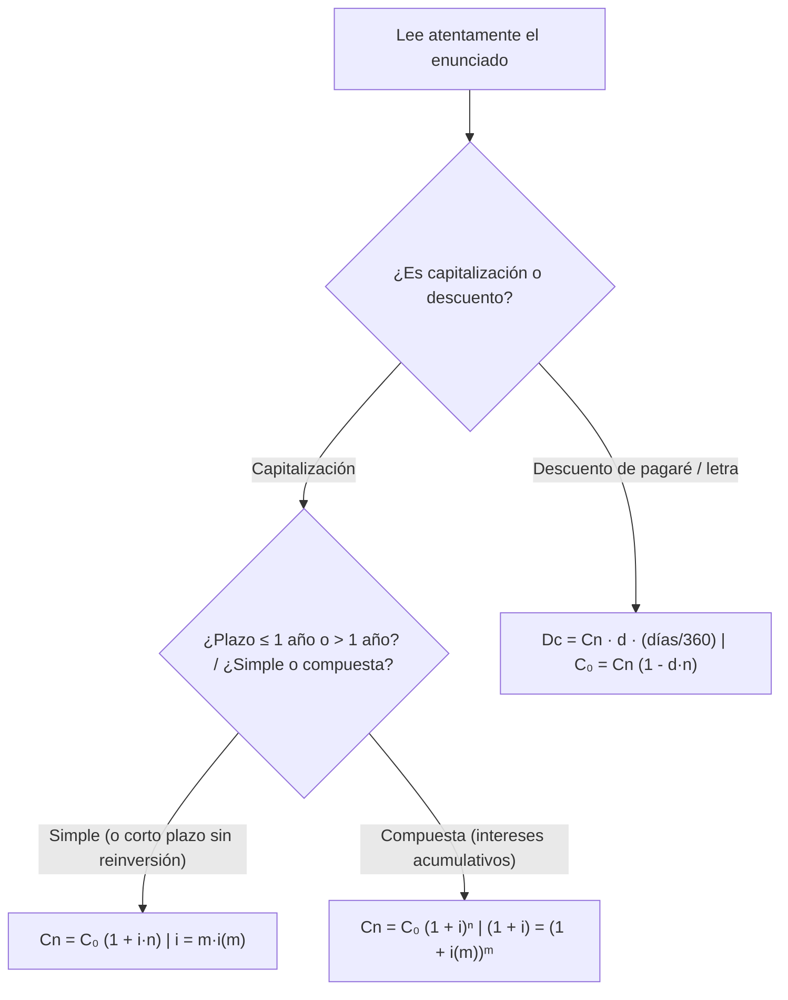

# 📈 Matemática de las Operaciones Financieras — Tema 2: Leyes Financieras

- **Asignatura:** Matemática de las Operaciones Financieras (Cód. 2346)
- **Titulación:** Grado en ADE — Facultad de Economía y Empresa (Universidad de Murcia)
- **Grupo:** Grupo 5 (Turno Tarde) · **Profesoras:** Mª del Rosario Hernández Carreño y Carmen Mª Hernández Nicolás
- **Documento fuente oficial:** *TEMA 2. LEYES FINANCIERAS (Curso 2026-2027)*
- **Archivos de diapositivas:** [TEMA 2 2026_27.pdf](./TEMA%202%20%202026_27.pdf) · [Tema_02_Leyes_Financieras_Presentacion_Oficial.pdf](./Tema_02_Leyes_Financieras_Presentacion_Oficial.pdf)
- **Objetivo clave:** Manual práctico y completo de estudio con todas las deducciones, fórmulas, relaciones de equivalencia y advertencias para la **Prueba I del jueves 15 de octubre**.

---

## 🧭 Diccionario Rápido de Nomenclatura Financiera

| Símbolo | Significado oficial | Qué representa en la práctica |
| :---: | :--- | :--- |
| $C_0$ | Capital inicial / Valor actual | Cantidad disponible o prestada en el momento inicial $t_0$. |
| $C_n$ | Capital final / Montante / Valor nominal | Cantidad devuelta o percibida al vencimiento $t_n$. |
| $n$ | Duración de la operación | $n = t_n - t_0$. **Debe coincidir en unidad temporal con el tipo de interés.** |
| $I$ | Intereses generados (postpagables) | Compensación pagada al vencimiento: $I = C_n - C_0$. |
| $I^*$ | Intereses anticipados | Descuento o interés retenido en $t_0$: cuantía líquida recibida $C = C_0 - I^*$. |
| $i$ | Tanto de interés postpagable anual | Rendimiento pactado por cada unidad monetaria por periodo. |
| $i^*$ | Tanto de interés anticipado | Rendimiento pactado liquidado al inicio de la operación. |
| $m$ | Frecuencia de capitalización | Número de subperiodos en los que se fracciona el año ($m=2$ semestres, $m=4$ trimestres, $m=12$ meses...). |
| $i(m)$ ó $i_m$ | Tanto efectivo subperiódico | Interés real generado en una fracción de año $1/m$. |
| $J_m$ | Tanto de Interés Nominal (TIN) | Tanto proporcional teórico anual: $J_m = m \cdot i(m)$. |
| $d$ | Tanto de descuento simple comercial | Factor de descuento aplicado directamente sobre el valor nominal $C_n$. |
| $D_c$ | Descuento simple comercial | Cantidad de dinero que retiene la entidad bancaria: $D_c = C_n - C_0$. |

---

## 1. 🔍 Introducción: Fundamento de la Operación Financiera

Una operación financiera es un intercambio no simultáneo de capitales pactado entre dos partes:
- **Acreedor (prestamista):** Cede $C_0$ en $t_0$.
- **Deudor (prestatario):** Devuelve $C_0$ más una contraprestación $\Delta C_0$ (intereses) en concepto de precio o alquiler del dinero.

---

## 2. ⚡ Ley Financiera de Capitalización Simple

### 2.1. Definición y Principio Fundamental
- **Definición:** Los intereses devengados en cada periodo se calculan **siempre y exclusivamente sobre el capital inicial $C_0$**.
- **Característica clave:** **Los intereses NO son productivos** (no se acumulan al capital para producir nuevos intereses en periodos siguientes).
- **Ámbito de aplicación:** Operaciones financieras a **corto plazo** ($n \le 1$ año).

### 2.2. Fórmulas de Cálculo y Despejes

$$C_n = C_0 \cdot (1 + i \cdot n)$$

$$I = C_n - C_0 = C_0 \cdot i \cdot n$$

- **Cálculo del Valor Actual ($C_0$):**
  $$C_0 = \frac{C_n}{1 + i \cdot n} = C_n \cdot (1 + i \cdot n)^{-1}$$

- **Despeje del Tiempo ($n$):**
  $$n = \frac{C_n - C_0}{C_0 \cdot i} = \frac{I}{C_0 \cdot i}$$

- **Despeje del Tanto de Interés ($i$):**
  $$i = \frac{C_n - C_0}{C_0 \cdot n} = \frac{I}{C_0 \cdot n}$$

---

### 2.3. Interés Anticipado en Capitalización Simple ($i^*$) y Equivalencia

- Si los intereses se liquidan por adelantado en $t_0$:
  $$I^* = C_0 \cdot i^* \cdot n$$
  $$C = C_0 - I^* = C_0 \cdot (1 - i^* \cdot n)$$

- **Relación de equivalencia entre $i$ (postpagable) e $i^*$ (anticipado):**
  Para que ambas operaciones resulten financieramente equivalentes sobre el mismo capital líquido:
  $$1 = (1 - i^* \cdot n) \cdot (1 + i \cdot n)$$

  $$\boxed{i = \frac{i^*}{1 - i^* \cdot n}} \qquad \Longleftrightarrow \qquad \boxed{i^* = \frac{i}{1 + i \cdot n}}$$

> ⚠️ **¡Atención Examen!** En capitalización simple, la equivalencia entre $i$ e $i^*$ **SÍ depende de la duración $n$** de la operación.

---

### 2.4. Fraccionamiento en Capitalización Simple: Tantos Equivalentes
Si los intereses se liquidan con frecuencia $m$ veces al año ($m = 2, 4, 12, \dots$):
- Montante anual: $C_n = C_0 (1 + i \cdot n)$
- Montante fraccionado: $C_n = C_0 (1 + m \cdot n \cdot i(m))$

Igualando montantes:
$$C_0 (1 + i \cdot n) = C_0 (1 + m \cdot n \cdot i(m)) \implies i \cdot n = m \cdot n \cdot i(m)$$

$$\boxed{i = m \cdot i(m)} \qquad \Longleftrightarrow \qquad \boxed{i(m) = \frac{i}{m}}$$

> 💡 **Conclusión:** En capitalización simple, la relación de equivalencia entre el tipo anual y el fraccionado es **proporcional pura** y es **única (no depende de la duración de la operación)**.

---

## 3. 📈 Ley Financiera de Capitalización Compuesta

### 3.1. Definición y Mecánica de Acumulación
- **Definición:** Los intereses producidos al final de cada periodo unitario de tiempo **se suman al capital inicial de dicho periodo**, y la suma de ambos constituye el nuevo capital que produce intereses en el siguiente periodo.
- **Característica clave:** **Los intereses SÍ son productivos** (generan nuevos intereses acumulativamente).
- **Ámbito de aplicación:** Operaciones a **medio y largo plazo** ($n > 1$ año).

**Deducción periodo a periodo:**
- Año 1: $C_1 = C_0 + I_1 = C_0 + C_0 \cdot i = C_0 (1 + i)$
- Año 2: $C_2 = C_1 + I_2 = C_1 (1 + i) = C_0 (1 + i)^2$
- Año 3: $C_3 = C_2 + I_3 = C_2 (1 + i) = C_0 (1 + i)^3$
- Año $n$:
  $$\boxed{C_n = C_0 \cdot (1 + i)^n}$$

---

### 3.2. Fórmulas de Despeje en Compuesta

- **Valor actual ($C_0$):**
  $$C_0 = \frac{C_n}{(1 + i)^n} = C_n \cdot (1 + i)^{-n}$$

- **Duración / Tiempo ($n$):**
  $$\frac{C_n}{C_0} = (1 + i)^n \implies \ln\left(\frac{C_n}{C_0}\right) = n \cdot \ln(1 + i) \implies \boxed{n = \frac{\ln(C_n / C_0)}{\ln(1 + i)}}$$

- **Tanto de interés ($i$):**
  $$\boxed{i = \left(\frac{C_n}{C_0}\right)^{\frac{1}{n}} - 1 = \sqrt[n]{\frac{C_n}{C_0}} - 1}$$

---

### 3.3. Cálculo de Intereses e Interés Anticipado en Compuesta

- **Interés total postpagable ($I$):**
  $$I = C_n - C_0 = C_0 (1 + i)^n - C_0 = \boxed{C_0 \cdot \left[(1 + i)^n - 1\right]}$$

- **Interés anticipado ($I^*$):**
  $$C = C_0 \cdot (1 - i^*)^n$$
  $$I^* = C_0 - C = \boxed{C_0 \cdot \left[1 - (1 - i^*)^n\right]}$$

- **Equivalencia entre tanto postpagable ($i$) y anticipado ($i^*$):**
  $$C_0 = C \cdot (1 + i)^n = C_0 (1 - i^*)^n (1 + i)^n \implies 1 = (1 - i^*)(1 + i)$$

  $$\boxed{i = \frac{i^*}{1 - i^*}} \qquad \Longleftrightarrow \qquad \boxed{i^* = \frac{i}{1 + i}}$$

> 💎 **¡Diferencia fundamental con la Simple!** En capitalización compuesta, la relación de equivalencia entre $i$ e $i^*$ es **única y NO depende de la duración $n$**.

---

### 3.4. Comparación Analítica y Gráfica: Simple vs Compuesta

Comparando las funciones de montante $C_n = C_0(1 + i \cdot n)$ y $C_n = C_0(1 + i)^n$:

| Tramo de tiempo | Relación de montantes | Explicación |
| :---: | :---: | :--- |
| **$n < 1$** | $C_{n, \text{Simple}} > C_{n, \text{Compuesta}}$ | La función $(1 + i \cdot n)$ es secante por encima de la curva exponencial $(1 + i)^n$ en el intervalo $(0,1)$. |
| **$n = 1$** | $C_{n, \text{Simple}} = C_{n, \text{Compuesta}}$ | Ambas valen $C_0(1 + i)$. |
| **$n > 1$** | $C_{n, \text{Compuesta}} > C_{n, \text{Simple}}$ | La acumulación de intereses sobre intereses hace crecer exponencialmente el capital. |

---

### 3.5. Fraccionamiento en Compuesta: TIN y Tanto Efectivo (TAE)

- **Frecuencia $m$:** Número de periodos de liquidación al año:
  - Semestral: $m = 2$
  - Cuatrimestral: $m = 3$
  - Trimestral: $m = 4$
  - Bimestral: $m = 6$
  - Mensual: $m = 12$
  - Diario: $m = 360$ (comercial) ó $m = 365$ (natural)

- **Tanto de Interés Nominal ($J_m$ o TIN):** Es un tanto contractual de referencia proporcional al tanto efectivo fraccionado:
  $$J_m = m \cdot i(m) \implies \boxed{i(m) = \frac{J_m}{m}}$$

  > 📝 *Ejemplo:* Si el banco ofrece un TIN del 2,8% nominal anual capitalizable por semestres ($J_2 = 0,028$):
  > $$i(2) = \frac{0,028}{2} = 0,014 \quad (1,4\% \text{ semestral})$$

- **Equivalencia entre Tantos Compuestos (Cálculo de la TAE / $i$ anual):**
  Dos tantos son equivalentes si en el mismo tiempo producen el mismo montante:
  $$C_0 (1 + i)^n = C_0 \left(1 + i(m)\right)^{n \cdot m}$$
  $$(1 + i) = (1 + i(m))^m$$

  $$\boxed{i = (1 + i(m))^m - 1 = \left(1 + \frac{J_m}{m}\right)^m - 1}$$

  $$\boxed{i(m) = (1 + i)^{\frac{1}{m}} - 1}$$

---

## 4. 📉 Ley Financiera de Descuento Simple Comercial

### 4.1. Definición y Mecánica
- **Definición:** Sustitución de un capital futuro $C_n$ (valor nominal del pagaré o letra de cambio) por su equivalente en el momento presente $C_0$ (efectivo descontado).
- **Principio:** El descuento aplicado es **proporcional a la duración de la operación y al valor nominal $C_n$**, siendo $d$ el tanto de descuento simple comercial.

### 4.2. Fórmulas Fundamentales

- **Descuento Comercial ($D_c$):**
  $$D_c = C_n \cdot d \cdot n$$
  Si el plazo viene dado en días (cómputo de días naturales entre $t_0$ y $t_n$ en año comercial de 360 días):
  $$\boxed{D_c = C_n \cdot d \cdot \frac{t\ (\text{días})}{360}}$$

- **Valor Efectivo / Descontado ($C_0$):**
  $$C_0 = C_n - D_c = C_n - C_n \cdot d \cdot n = \boxed{C_n \cdot (1 - d \cdot n)}$$

- **Despejes clave:**
  $$n = \frac{C_n - C_0}{C_n \cdot d} = \frac{D_c}{C_n \cdot d}$$
  $$d = \frac{C_n - C_0}{C_n \cdot n} = \frac{D_c}{C_n \cdot n}$$

> ⚠️ **Límite matemático del descuento comercial:** Para que $C_0 > 0$, es obligatorio que $1 - d \cdot n > 0 \implies n < \frac{1}{d}$. Por ello, esta ley solo es aplicable a **plazos muy cortos** (generalmente meses o días).

---

## 5. 🛠️ RECETARIO PRÁCTICO PARA EL EXAMEN DEL JUEVES

### Trampas Típicas en los Exámenes de MOF
1. **Confundir $n$ con la frecuencia $m$:** Asegúrate de que $n$ y el tipo de interés estén siempre expresados en la **misma unidad temporal**. Si usas $i(12)$, el tiempo $n$ debe ser el número de meses. Si usas $i$ anual, $n$ debe estar en años.
2. **Convertir TIN a TAE:** El TIN ($J_m$) **nunca** se mete directo en la fórmula del montante anual sin dividir entre $m$: primero calcula $i(m) = J_m / m$, y luego $(1 + i) = (1 + i(m))^m$.
3. **Cómputo comercial de 360 vs natural de 365:** Salvo que el enunciado indique explícitamente año civil (365), en operaciones de descuento comercial y mercado financiero a corto plazo se divide entre **360 días**.
