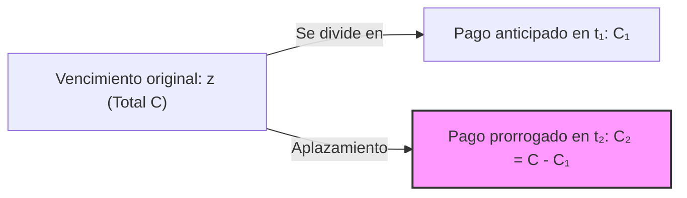

# 📊 Matemática de las Operaciones Financieras — Tema 3: Unificación de Capitales

- **Asignatura:** Matemática de las Operaciones Financieras (Cód. 2346)
- **Titulación:** Grado en ADE — Facultad de Economía y Empresa (Universidad de Murcia)
- **Grupo:** Grupo 5 (Turno Tarde) · **Profesoras:** Mª del Rosario Hernández Carreño y Carmen Mª Hernández Nicolás
- **Documento fuente oficial:** *TEMA 3. UNIFICACIÓN DE CAPITALES (Curso 2026-2027)*
- **Archivos de diapositivas:** [TEMA 3 2026_27.pdf](./TEMA%203%20%202026_27.pdf) · [Tema_03_Unificacion_de_Capitales_Presentacion_Oficial.pdf](./Tema_03_Unificacion_de_Capitales_Presentacion_Oficial.pdf)

---

## 🧭 Conceptos Clave y Nomenclatura

| Símbolo | Significado | Descripción práctica |
| :---: | :--- | :--- |
| $(C_s, t_s)$ | Capital financiero individual | Cuantía $C_s$ con vencimiento en la fecha $t_s$. |
| $(C, z)$ | Capital sustituto único | Capital unificado de cuantía $C$ con fecha de vencimiento $z$. |
| $p$ | Punto de valoración | Momento temporal elegido para plantear la ecuación de equivalencia financiera. |
| **Vencimiento Común** | $C \neq \sum C_s$ | El importe total $C$ se fija de antemano distinto a la suma aritmética simple. |
| **Vencimiento Medio** | $C = \sum C_s$ | La cuantía sustituta es exactamente la **suma aritmética** de los capitales originales. |
| $pr$ | Prórroga de vencimiento | Plazo adicional concedido para aplazar un pago: $pr = t_2 - z$. |

---

## 1. 🎯 Vencimiento Común y Vencimiento Medio

Queremos sustituir un conjunto de capitales $(C_1, t_1), (C_2, t_2), \dots, (C_k, t_k)$ por un único capital $(C, z)$ equivalente.

### 1.1. Elección del Punto de Valoración ($p$)
Para no mezclar sentidos de cálculo en la equivalencia:
- **En Leyes de Capitalización (Simple o Compuesta):** Se toma como punto de valoración **el vencimiento del último capital** ($p = t_k$). Así todos los capitales se capitalizan hacia adelante y se cumple la normativa del Banco de España (valorar en la fecha de extinción).
- **En Leyes de Descuento Simple Comercial:** Se toma como punto de valoración **la fecha inicial o de negociación** ($p = t_0$). Así todos los capitales se descuentan hacia atrás.

---

### 1.2. Planteamiento en Capitalización Simple

Con punto de valoración en $p = t_k$:

$$\sum_{s=1}^k C_s \left(1 + i \cdot \frac{p - t_s}{360}\right) = C \cdot \left(1 + i \cdot \frac{p - z}{360}\right)$$

#### A) Si buscamos el Vencimiento Común ($C$ fijado, $C \neq \sum C_s$):
Despejamos $z$:
$$p - z = \frac{\sum_{s=1}^k C_s \left(1 + i \cdot \frac{p - t_s}{360}\right) - C}{C \cdot \frac{i}{360}}$$

#### B) Si buscamos el Vencimiento Medio ($C = \sum C_s$):
Sustituyendo $C = \sum C_s$ y simplificando:
$$\sum C_s + \sum C_s \cdot i \cdot \frac{p - t_s}{360} = \sum C_s + \left(\sum C_s\right) \cdot i \cdot \frac{p - z}{360}$$
$$p - z = \frac{\sum C_s (p - t_s)}{\sum C_s} \implies \boxed{z = \frac{\sum_{s=1}^k C_s \cdot t_s}{\sum_{s=1}^k C_s}}$$

> 💡 **Propiedad de Oro del Vencimiento Medio:** El vencimiento medio es la **media ponderada de los vencimientos por sus respectivas cuantías**.  
> **NO depende del tipo de interés ($i$) ni del punto de valoración ($p$)**, y se puede operar directamente en días, meses o años.

---

### 1.3. Planteamiento en Capitalización Compuesta

Con punto de valoración en $p = t_k$:

$$\sum_{s=1}^k C_s \cdot (1 + i)^{p - t_s} = C \cdot (1 + i)^{p - z}$$

- Despejando el capital $C$ (si se conoce $z$):
  $$C = \frac{\sum C_s (1 + i)^{p - t_s}}{(1 + i)^{p - z}}$$
- Despejando el vencimiento $z$ (si se conoce $C$):
  $$(1 + i)^{p - z} = \frac{\sum C_s (1 + i)^{p - t_s}}{C} \implies p - z = \frac{\ln\left(\frac{\sum C_s (1 + i)^{p - t_s}}{C}\right)}{\ln(1 + i)}$$

---

### 1.4. Planteamiento en Descuento Simple Comercial

Con punto de valoración en $p = t_0$:

$$\sum_{s=1}^k C_s \left(1 - d \cdot \frac{t_s - p}{360}\right) = C \cdot \left(1 - d \cdot \frac{z - p}{360}\right)$$

Si es vencimiento medio ($C = \sum C_s$):
$$z - p = \frac{\sum C_s (t_s - p)}{\sum C_s} \implies \boxed{z = \frac{\sum C_s \cdot t_s}{\sum C_s}}$$

---

## 2. 🔄 Sustitución de Capitales

Consiste en la operación inversa: sustituir un único capital $(C, z)$ por dos capitales $(C_1, t_1)$ y $(C_2, t_2)$ tales que:
$$C_1 + C_2 = C$$

### 2.1. Resolución bajo Capitalización Simple (tomando $p = t_2$)
$$\begin{cases} C_1 \left(1 + i \cdot \frac{t_2 - t_1}{360}\right) + C_2 = C \left(1 + i \cdot \frac{t_2 - z}{360}\right) \\ C_1 + C_2 = C \end{cases}$$

Restando ambas ecuaciones:
$$\boxed{C_1 \cdot (t_2 - t_1) = C \cdot (t_2 - z)} \implies C_1 = C \cdot \frac{t_2 - z}{t_2 - t_1}$$
$$C_2 = C - C_1$$

### 2.2. Resolución bajo Descuento Comercial (tomando $p = t_1$)
$$\begin{cases} C_1 + C_2 \left(1 - d \cdot \frac{t_2 - t_1}{360}\right) = C \left(1 - d \cdot \frac{z - t_1}{360}\right) \\ C_1 + C_2 = C \end{cases}$$

Restando:
$$\boxed{C_2 \cdot (t_2 - t_1) = C \cdot (z - t_1)} \implies C_2 = C \cdot \frac{z - t_1}{t_2 - t_1}$$
$$C_1 = C - C_2$$

---

## 3. ⏳ Prórroga de Vencimientos

Se produce cuando un deudor anticipa una parte de la deuda $C_1$ a la fecha $t_1 < z$, y solicita aplazar el resto $C_2 = C - C_1$ hasta una fecha posterior $t_2 > z$.

- **Plazo de prórroga ($pr$):**
  $$\boxed{pr = t_2 - z}$$
- Se resuelve aplicando las fórmulas de sustitución de capitales y despejando $t_2$.
