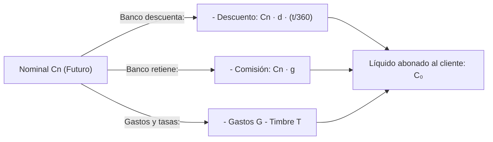

# 🏦 Matemática de las Operaciones Financieras — Tema 4: Estudio de las Operaciones Activas a Corto Plazo (Descuento Bancario)

- **Asignatura:** Matemática de las Operaciones Financieras (Cód. 2346)
- **Titulación:** Grado en ADE — Facultad de Economía y Empresa (Universidad de Murcia)
- **Grupo:** Grupo 5 (Turno Tarde) · **Profesoras:** Mª del Rosario Hernández Carreño y Carmen Mª Hernández Nicolás
- **Documento fuente oficial:** *TEMA 4. ESTUDIO DE LAS OPERACIONES ACTIVAS A CORTO PLAZO (Curso 2026-2027)*
- **Archivos de diapositivas:** [TEMA 4 2026_27.pdf](./TEMA%204%20%202026_27.pdf) · [Tema_04_Operaciones_Activas_Corto_Plazo_Presentacion_Oficial.pdf](./Tema_04_Operaciones_Activas_Corto_Plazo_Presentacion_Oficial.pdf)

---

## 🧭 Nomenclatura y Variables del Descuento Bancario

| Símbolo | Concepto | Definición y tratamiento |
| :---: | :--- | :--- |
| $C_n$ | Valor nominal | Importe facial del efecto comercial (letra de cambio o pagaré). |
| $C_0$ | Efectivo neto recibido | Dinero líquido real que el banco abona al cliente tras deducciones. |
| $d$ | Tanto de descuento anual | Tipo de interés de descuento bancario pactado (base 360 días). |
| $t$ | Días de descuento | Días naturales transcurridos desde la fecha de negociación hasta el vencimiento. |
| $g$ | Comisión de cobranza | Porcentaje cobrado sobre el nominal ($C_n \cdot g$). |
| $G$ | Gastos suplidos / fijos | Gastos de correo, domiciliación, verificación bancaria. |
| $T$ | Timbre oficial | Impuesto de Actos Jurídicos Documentados (Hacienda Pública). |
| $D$ | Divisor fijo | $D = \frac{360}{d}$ (facilita calcular el descuento por números comerciales). |
| $N$ | Números comerciales | $N = C_n \cdot t$ (producto del nominal por los días de descuento). |
| $V_m$ | Vencimiento medio | Media ponderada de los días de descuento de una remesa. |
| $r_c, d_c$ | Rédito y tanto efectivo cliente | Coste real del descuento para la empresa (base 365 días). |
| $r_b, d_b$ | Rédito y tanto efectivo entidad | Rentabilidad real obtenida por el banco (base 365 días). |

---

## 1. 📑 Descuento de un Efecto Comercial Aislado

El banco adelanta al cliente el importe de una letra de cambio con vencimiento futuro $t_n$, reteniendo el descuento comercial y los gastos/comisiones de gestión.

### 1.1. Obtención del Líquido para el Cliente ($C_0$)

$$C_0 = C_n \left(1 - d \cdot \frac{t}{360} - g\right) - G - T$$

### 1.2. Coste Efectivo para el Cliente ($d_c$) — Base 365 días
Para calcular el coste financiero soportado por el cliente se compara el coste total soportado con el nominal:
- **Rédito de coste:**
  $$r_c = \frac{C_n - C_0}{C_n}$$
- **Tanto de descuento efectivo anual (Coste):**
  $$\boxed{d_c = \frac{C_n - C_0}{C_n} \cdot \frac{365}{t}}$$

### 1.3. Rentabilidad para la Entidad Financiera ($d_b$)
Para el banco:
- **No es ingreso el Timbre ($T$):** Lo recauda para entregárselo a la Hacienda Pública.
- **No son ingreso los gastos suplidos ($G$):** Son costes reales asumidos por el banco y repercutidos al cliente sin margen.
- **Efectivo entregado por la entidad ($C_{0b}'$):**
  $$C_{0b}' = C_n \left(1 - d \cdot \frac{t}{360} - g\right) = C_0 + G + T$$
- **Tanto de rendimiento bancario:**
  $$\boxed{d_b = \frac{C_n - C_{0b}'}{C_n} \cdot \frac{365}{t}}$$

---

## 2. 📦 Descuento de una Remesa de Efectos

Una empresa presenta simultáneamente varias letras de cambio en una **factura de descuento**.

### 2.1. Cálculo del Efectivo Global con el Método del Divisor Fijo
Definiendo el **divisor fijo**:
$$D = \frac{360}{d}$$
El descuento comercial total de la remesa es la suma de los números comerciales entre el divisor fijo:
$$\sum D_{cs} = \frac{\sum C_s \cdot t_s}{D}$$

El efectivo total recibido por el cliente es:
$$\boxed{C_0 = \sum C_s - \frac{\sum C_s \cdot t_s}{D} - \sum (C_s \cdot g_s) - \sum G_s - \sum T_s}$$

### 2.2. Vencimiento Medio y Tantos Efectivos Medios de la Remesa
- **Vencimiento medio en días ($V_m$):**
  $$V_m = \frac{\sum C_s \cdot t_s}{\sum C_s}$$
- **Coste efectivo medio cliente ($d_{mc}$):**
  $$\boxed{d_{mc} = \frac{\sum C_s - C_0}{\sum C_s} \cdot \frac{365}{V_m}}$$
- **Rentabilidad media banco ($d_{mb}$):**
  $$\boxed{d_{mb} = \frac{\sum C_s - C_{0b}'}{\sum C_s} \cdot \frac{365}{V_m}} \qquad \text{donde } C_{0b}' = C_0 + \sum G_s + \sum T_s$$

---

## 3. 🎯 La T.A.E. en Operaciones de Descuento (Normativa Banco de España)

Regulada en la **Circular 8/90 del Banco de España (Norma 8ª, punto 4.d)**:

### ⚠️ Reglas Obligatorias de Exclusión:
1. **Efectos a menos de 15 días ($t < 15$):** **NO se consideran descontados a efectos de TAE.** Se consideran meras operaciones de cobro y se eliminan totalmente del cálculo de la TAE (se resta su nominal y no entran en el cómputo).
2. **Comisiones que excedan del mínimo tarifado:** Solo entra en el coste de la TAE la parte de la comisión de cobranza que **exceda del mínimo tarifado ($M$)** fijado por el banco:
   $$\text{Comisión computable} = \max(0, \, C_s \cdot g_s - M)$$
3. **Ni timbres ($T$) ni gastos suplidos ($G$) entran en la TAE.**

### Fórmula de la TAE:
Con los efectos admisibles ($\ge 15$ días):
$$C_0' = \sum C_s' - \frac{\sum C_s' \cdot t_s'}{D} - \sum \max(0, \, C_s' \cdot g_s' - M)$$
$$V_m' = \frac{\sum C_s' \cdot t_s'}{\sum C_s'}$$

$$\sum C_s' = C_0' \cdot (1 + \text{TAE})^{\frac{V_m'}{360}} \implies \boxed{\text{TAE} = \left(\frac{\sum C_s'}{C_0'}\right)^{\frac{360}{V_m'}} - 1}$$

---

## 4. 🪟 Descuento de Letras Persiana

Conjunto de $n$ letras de **idéntico nominal $C$** con vencimientos periódicos constantes cada fracción $1/m$ de año (habitualmente mensuales, $m=12$, procedentes de ventas a plazos como automóviles o hipotecas).

- Vencimiento de cada letra $s$: $t_s = \frac{s}{m}$ (para $s = 1, 2, \dots, n$).
- Vencimiento medio en años:
  $$V_m = \frac{n + 1}{2 \cdot m} \quad \text{años}$$
- **Efectivo neto percibido:**
  $$\boxed{C_0 = n \cdot C \cdot \left(1 - d \cdot \frac{n + 1}{2 \cdot m} - g\right) - \sum G - \sum T}$$
- **Tanto medio de coste:**
  $$d_{mc} = \frac{n \cdot C - C_0}{n \cdot C \cdot \frac{n + 1}{2 \cdot m}}$$

---

## 5. 🛑 Efectos Impagados y Letras de Resaca

### 5.1. Consecuencias del Impago de una Letra
Si el deudor (librado) no paga al vencimiento, el banco protesta la letra (o realiza declaración notarial equivalente) y carga de inmediato en la cuenta del cliente (librador) el importe total de devolución ($E$):

$$\boxed{E = C_n + C_d \cdot C_n + G_p + C_p \cdot C_n + G_d}$$

- $C_n$: Nominal devuelto impagado.
- $C_d$: Comisión bancaria por devolución (% sobre $C_n$).
- $G_p$: Gastos notariales de protesto.
- $C_p$: Comisión de gestión de protesto cobrada por el banco.
- $G_d$: Gastos de comunicación (correo, burofax, etc.).

### 5.2. Emisión de la Letra de Resaca
El librador gira una nueva letra llamada **letra de resaca** con un vencimiento posterior $t_s$ para recuperar el dinero impagado. 
Como el deudor moroso debe asumir todos los perjuicios del impago más el nuevo timbre:
$$E + T = N \cdot \left(1 - d \cdot \frac{t_s}{360} - g\right)$$

$$\boxed{N = \frac{E + T}{1 - d \cdot \frac{t_s}{360} - g}}$$

El importe nominal $N$ de la nueva letra asegura que, al descontarla en el banco hoy, se recupera exactamente la totalidad del quebranto ($E$) más el coste del nuevo timbre fiscal ($T$).
