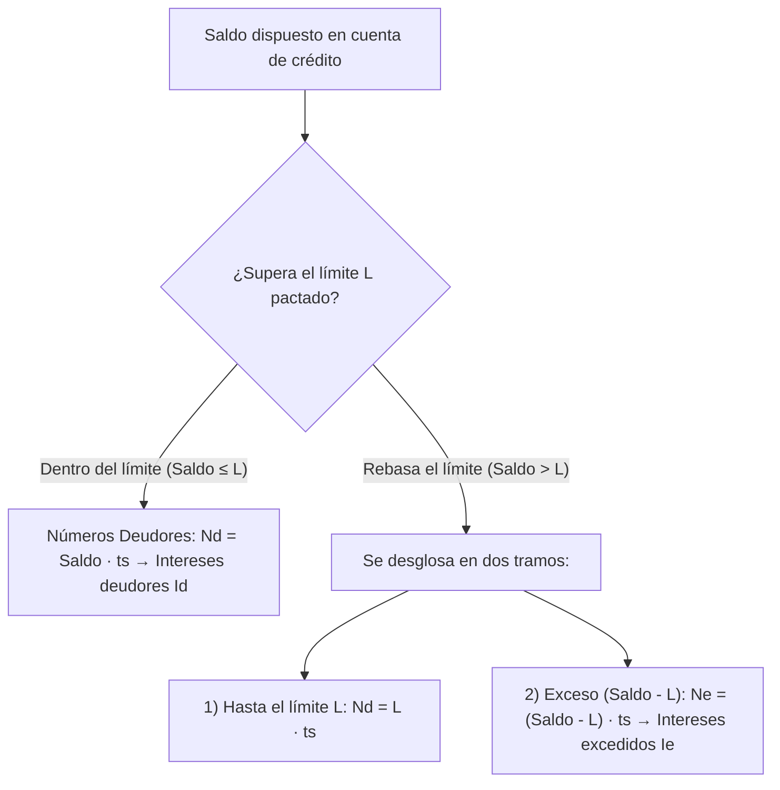

# 💳 Matemática de las Operaciones Financieras — Tema 5: Estudio de las Operaciones Pasivas y Activas a Corto Plazo (Cuentas Corrientes y Cuentas de Crédito)

- **Asignatura:** Matemática de las Operaciones Financieras (Cód. 2346)
- **Titulación:** Grado en ADE — Facultad de Economía y Empresa (Universidad de Murcia)
- **Grupo:** Grupo 5 (Turno Tarde) · **Profesoras:** Mª del Rosario Hernández Carreño y Carmen Mª Hernández Nicolás
- **Documento fuente oficial:** *TEMA 5. ESTUDIO DE LAS OPERACIONES PASIVAS A CORTO PLAZO (Curso 2026-2027)*
- **Archivos de diapositivas:** [TEMA 5 2026_27.pdf](./TEMA%205%20%202026_27.pdf) · [Tema_05_Operaciones_Pasivas_Corto_Plazo_Presentacion_Oficial.pdf](./Tema_05_Operaciones_Pasivas_Corto_Plazo_Presentacion_Oficial.pdf)

---

## 🧭 Nomenclatura y Variables

| Símbolo | Concepto | Definición en el cálculo |
| :---: | :--- | :--- |
| **Fecha Valor** | Fecha de eficacia financiera | Fecha a partir de la cual un abono o cargo devenga o deja de devengar intereses. |
| $t_s$ | Días de vigencia del saldo | Días transcurridos entre dos fechas valor consecutivas. |
| $N$ | Números comerciales | $N = \text{Saldo} \times t_s$ (saldo multiplicado por los días que permanece constante). |
| $D$ | Divisor fijo | $D = \frac{365}{j_m}$ (en cuentas remuneradas, base 365) ó $D = \frac{360}{j}$ (en créditos, base 360). |
| $S_{min}$ | Saldo mínimo | Umbral necesario para devengar el tipo de interés preferente. |
| $F$ | Franquicia | Importe no remunerado; sólo devenga intereses el exceso $(S_m - F)$. |
| $C_m, C_a$ | Comisiones de cuenta | Comisión de mantenimiento periódica ($C_m$) y por apunte contable ($C_a$). |
| $t_{ret}$ | Retención fiscal IRPF | Retención legal a cuenta del IRPF (actualmente **19%** sobre intereses brutos). |
| $L$ | Límite de la póliza de crédito | Importe máximo de saldo deudor autorizado por el banco. |
| $C_{disp}$ | Comisión de disponibilidad | Comisión aplicada sobre el **saldo medio no dispuesto** en créditos. |
| $C_{exc}$ | Comisión de excedido | Porcentaje sobre el mayor saldo excedido sobre el límite en el trimestre. |

---

## 1. 🍔 El Método Hamburgués (Escalar) de Liquidación

Es el método universal aplicado por el sistema bancario español:
1. Las operaciones se ordenan de forma rigurosa por **fecha valor** (no por fecha contable de la operación).
2. Se calcula el **saldo acumulado** tras cada apunte.
3. Se calcula el número de días naturales ($t_s$) que dicho saldo permanece inalterado hasta la siguiente fecha valor.
4. Se obtienen los **números comerciales**:
   $$N = \text{Saldo} \cdot t_s$$

---

## 2. 💰 Liquidación de Cuentas Corrientes Remuneradas (Operación de Pasivo)

> 📌 **Base de cálculo:** **365 días** (por ser una operación de pasivo para el banco: el cliente deposita dinero y el banco le remunera). No se admiten descubiertos.

### 2.1. Saldo Mínimo y Franquicia
- **Condición de Saldo Mínimo ($S_{min}$):**
  - Si el saldo medio $\ge S_{min}$: se remunera al tipo pactado $j_m$.
  - Si el saldo medio $< S_{min}$: no se remunera o se aplica el tipo residual no primado $j_m'$ (típicamente $0,1\%$).
- **Franquicia ($F$):**
  El banco no retribuye los primeros $F$ euros de saldo:
  $$N = (S_m - F) \cdot t_s$$

### 2.2. Cálculo de Intereses Brutos y Netos
- **Intereses brutos devengados ($I_T$):**
  $$I_T = \frac{\sum N}{D} + \frac{\sum N'}{D'} \qquad \text{donde } D = \frac{365}{j_m}$$
- **Intereses netos tras retención fiscal y comisiones ($I_N$):**
  Por imperativo legal, el banco practica una retención del **19% de IRPF**:
  $$\boxed{I_N = I_T \cdot (1 - 0,19) - C_m - h \cdot C_a}$$
  *(siendo $h$ el número de apuntes sujetos a comisión).*

- **Saldo final a cuenta nueva ($S_{\text{nuevo}}$):**
  $$S_{\text{nuevo}} = S_{\text{anterior}} + I_T - 0,19 \cdot I_T - C_m - h \cdot C_a$$

### 2.3. Rentabilidad Efectiva Anual (TAE aproximada para el Cliente)
Para calcular el rendimiento financiero anual del cliente **no se deduce la retención de IRPF** (puesto que es un pago a cuenta del impuesto sobre la renta del propio titular):

$$\boxed{i_{\text{rent}} = \left(1 + \frac{I_T - C_m - h \cdot C_a}{\text{Saldo Medio}}\right)^{\frac{365}{\sum t_s}} - 1}$$

$$\text{donde } \text{Saldo Medio} = \frac{\sum N}{\sum t_s}$$

---

## 3. 📈 Cuentas Corrientes de Crédito (Pólizas de Crédito)

> 📌 **Naturaleza:** El banco pone a disposición del cliente liquidez hasta un **límite fijado ($L$)**, formalizado en una póliza intervenida ante notario. El cliente dispone del dinero solo cuando lo necesita.  
> 📌 **Base de cálculo:** **360 días** (operación activa para el banco), liquidada por **trimestres naturales**.

### 3.1. Tipos de Interés y Números Comerciales Aplicados
En la liquidación trimestral se aplican tres tramos:
1. **Intereses Deudores ($I_d$):** aplicados a la parte dispuesta dentro del límite $L$:
   $$I_d = \frac{\sum N_d}{D_d} \qquad \left(D_d = \frac{360}{j_d}\right)$$
2. **Intereses de Excedidos ($I_e$):** penalización por la cuantía que supera el límite ($Saldo - L$):
   $$I_e = \frac{\sum N_e}{D_e} \qquad \left(D_e = \frac{360}{j_e}\right)$$
3. **Intereses Acreedores ($I_a$):** si en algún momento el cliente tiene saldo a su favor:
   $$I_a = \frac{\sum N_a}{D_a} \qquad \left(D_a = \frac{360}{j_a}\right)$$

---

### 3.2. Comisiones en Cuentas de Crédito

- **En la apertura de la póliza:**
  - Comisión de apertura ($C_{ap}$): $\%$ sobre el límite total concedido $L$.
  - Comisión de estudio ($C_{es}$), corretaje notarial.
- **En la liquidación trimestral:**
  - **Comisión de disponibilidad ($C_{disp}$):** Se cobra sobre el **saldo medio no dispuesto**, porque el banco ha tenido esos fondos reservados:
    $$\text{Saldo medio dispuesto} = \frac{\sum N_d}{\sum t_s}$$
    $$\text{Saldo medio NO dispuesto} = L - \text{Saldo medio dispuesto}$$
    $$\boxed{C_{disp} = \text{Porcentaje} \times (L - \text{Saldo medio dispuesto})}$$
  - **Comisión por excedidos ($C_{exc}$):** $\%$ calculado sobre el **mayor saldo excedido** registrado durante todo el trimestre.

---

### 3.3. Saldo a Cuenta Nueva del Crédito
$$S_{\text{nuevo}} = S_{\text{anterior}} + I_d - I_a + I_e + C_{disp} + C_{exc} + \text{Retención IRPF si procede sobre } I_a$$

---

### 3.4. TAE Oficial según el Banco de España (Circular 8/90)

Para la póliza de crédito ($m=4$ trimestres al año, duración $n$ años):
- **Gastos iniciales trimestrales:**
  $$\text{Gastos iniciales} = \frac{C_{ap} + C_{es}}{n \cdot 4}$$
- **Tipo trimestral base:**
  $$i_4 = \frac{j_d}{4}$$
- **Tipo efectivo trimestral ampliado ($i_4'$):**
  $$i_4' = i_4 + \text{Gastos iniciales}$$
- **TAE Oficial:**
  $$\boxed{\text{TAE} = (1 + i_4')^4 - 1}$$

---

### 3.5. Coste Efectivo Real Trimestral del Cliente

$$\boxed{i_{\text{coste}} = \left(1 + \frac{I_d - I_a + I_e + C_{disp} + C_{exc}}{\text{Saldo Medio Dispuesto Total}}\right)^{\frac{365}{\sum t_s}} - 1}$$

$$\text{donde } \text{Saldo Medio Dispuesto Total} = \frac{\sum N_d - \sum N_a + \sum N_e}{\sum t_s}$$
