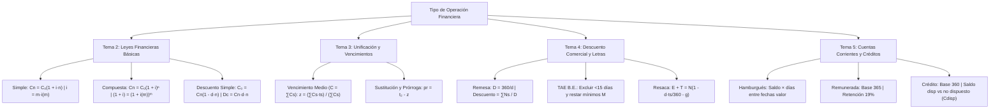

# 📋 Chuleta Maestra y Formulario de Examen: MOF (Temas 2 al 5)
### 🚨 Documento Especial de Preparación Rápida — Prueba I (Jueves, 15 de Octubre)

- **Asignatura:** Matemática de las Operaciones Financieras (Cód. 2346) — Grado en ADE (Universidad de Murcia)
- **Ámbito:** Preparación intensiva de los temas prácticos que entran en la Prueba I: **Tema 2, Tema 3, Tema 4 y Tema 5**. *(Tema 1 omitido por ser conceptual y directo)*.

---

## 🗺️ Mapa Rápido de Fórmulas y Decisiones

---

## ⚖️ Tabla Comparativa de Bases Temporales (¡Trampa #1 de Examen!)

| Operación | Base de días | ¿Por qué? |
| :--- | :---: | :--- |
| **Cálculo de Descuento Comercial / Remesas ($D_c$)** | **360 días** | Estándar mercantil bancario a corto plazo. |
| **Pólizas / Cuentas de Crédito ($I_d, I_e, I_a$)** | **360 días** | Operación activa del banco (préstamo/crédito al cliente). |
| **Coste Efectivo Cliente ($d_c, d_{mc}$) y Rentabilidad Banco ($d_b, d_{mb}$)** | **365 días** | Tantos anualizados efectivos reales de rentabilidad/coste. |
| **Cuentas Corrientes Remuneradas ($I_T$)** | **365 días** | Operación de pasivo para el banco (el cliente ahorra). |
| **Cómputo de la TAE Oficial (Banco de España)** | **360 días** | Fórmula circular B.E. para descuento bancario: $(1 + \text{TAE})^{V_m/360}$. |

---

## 📌 TEMA 2: Leyes Financieras

### 1. Capitalización Simple (Corto Plazo $\le 1$ año — Intereses NO productivos)
- **Montante:** $C_n = C_0 (1 + i \cdot n)$
- **Intereses:** $I = C_0 \cdot i \cdot n = C_n - C_0$
- **Interés anticipado ($i^*$):** $C = C_0 (1 - i^* \cdot n)$
  $$\boxed{i = \frac{i^*}{1 - i^* \cdot n}} \qquad \Longleftrightarrow \qquad \boxed{i^* = \frac{i}{1 + i \cdot n}} \quad \text{(¡Depende de } n \text{!)}$$
- **Fraccionamiento:** $i = m \cdot i(m) \implies i(m) = \frac{i}{m}$

### 2. Capitalización Compuesta (Medio/Largo Plazo — Intereses SÍ productivos)
- **Montante:** $C_n = C_0 (1 + i)^n$
- **Tiempo ($n$):** $n = \frac{\ln(C_n / C_0)}{\ln(1 + i)}$
- **Interés anticipado ($i^*$):** $C = C_0 (1 - i^*)^n$
  $$\boxed{i = \frac{i^*}{1 - i^*}} \qquad \Longleftrightarrow \qquad \boxed{i^* = \frac{i}{1 + i}} \quad \text{(¡NO depende de } n \text{!)}$$
- **TIN vs TAE / Fraccionamiento:**
  $$i(m) = \frac{J_m}{m} \qquad \Longleftrightarrow \qquad \boxed{1 + i = (1 + i(m))^m \implies \text{TAE} = \left(1 + \frac{J_m}{m}\right)^m - 1}$$

### 3. Regla de Oro Gráfica:
- Si $n < 1$: Simple $>$ Compuesta.
- Si $n = 1$: Simple $=$ Compuesta $= C_0 (1 + i)$.
- Si $n > 1$: Compuesta $>$ Simple.

---

## 📌 TEMA 3: Unificación de Capitales

Sustituir varios capitales $(C_1, t_1), (C_2, t_2), \dots, (C_k, t_k)$ por uno solo $(C, z)$:
- **Punto de valoración ($p$):**
  - En capitalización $\to$ **$p = t_k$ (el último vencimiento)**.
  - En descuento $\to$ **$p = t_0$ (fecha de hoy / negociación)**.

### 1. Vencimiento Medio ($C = \sum C_s$)
$$\boxed{z = \frac{\sum_{s=1}^k C_s \cdot t_s}{\sum_{s=1}^k C_s}}$$
*(Media ponderada directa en días. **No depende del tipo de interés**).*

### 2. Sustitución de 2 Capitales ($C_1 + C_2 = C$)
- En simple con $p = t_2$: $\boxed{C_1 (t_2 - t_1) = C (t_2 - z)}$
- En descuento con $p = t_1$: $\boxed{C_2 (t_2 - t_1) = C (z - t_1)}$

### 3. Prórroga de Vencimiento
Se aplaza parte de la deuda $C_2$ a $t_2$:
$$\boxed{pr = t_2 - z}$$

---

## 📌 TEMA 4: Operaciones Activas (Descuento Comercial)

### 1. Efectivo de una Remesa
- Divisor fijo: $D = \frac{360}{d}$
- Descuento total: $\sum D_c = \frac{\sum (C_s \cdot t_s)}{D} = \frac{\sum N_s}{D}$
- Líquido cliente: $\boxed{C_0 = \sum C_s - \sum D_c - \sum (C_s \cdot g_s) - \sum G - \sum T}$

### 2. Coste Cliente vs Rendimiento Banco (Base 365)
- Vencimiento medio: $V_m = \frac{\sum C_s \cdot t_s}{\sum C_s}$ (días).
- **Coste cliente:** $d_{mc} = \frac{\sum C_s - C_0}{\sum C_s} \cdot \frac{365}{V_m}$
- **Rentabilidad banco:** $d_{mb} = \frac{\sum C_s - C_{0b}'}{\sum C_s} \cdot \frac{365}{V_m}$ *(donde $C_{0b}' = C_0 + \sum G + \sum T$)*.

### 3. TAE Oficial del Banco de España (Circular 8/90)
1. **Eliminar letras con $t < 15$ días** (no son descuento).
2. **Comisiones:** solo computa el exceso sobre el mínimo: $\max(0, \, C_s \cdot g_s - M)$.
3. Timbres y gastos fijos **no entran**.
4. $\boxed{\text{TAE} = \left(\frac{\sum C_s'}{C_0'}\right)^{\frac{360}{V_m'}} - 1}$

### 4. Letras Persiana y Letras de Resaca
- **Persiana ($n$ letras de nominal $C$ mensuales):** $V_m = \frac{n+1}{2m}$ años.
- **Impago y Resaca:**
  - Quebranto: $E = C_n (1 + C_d + C_p) + G_p + G_d$
  - Nominal nueva letra: $\boxed{N = \frac{E + T}{1 - d \cdot \frac{t_s}{360} - g}}$

---

## 📌 TEMA 5: Cuentas Corrientes y Pólizas de Crédito

### 1. Método Hamburgués
Ordenar por **fecha valor**. Calcular días $t_s$ entre fechas valor consecutivas. Números comerciales: $N = \text{Saldo} \cdot t_s$.

### 2. Cuentas Remuneradas (Base 365 — Pasivo)
- Divisor fijo: $D = \frac{365}{j_m}$
- Franquicia $F$: se calculan números sobre $(S_m - F)$.
- Retención fiscal: **19% sobre intereses brutos $I_T$**.
- Líquido neto: $\boxed{I_N = I_T \cdot (1 - 0,19) - C_m - h \cdot C_a}$

### 3. Cuentas Corrientes de Crédito (Base 360 — Activo)
- **Tramos de saldo:**
  - Si $\text{Saldo} \le L$: $N_d = \text{Saldo} \cdot t_s \implies I_d = \sum N_d / D_d$
  - Si $\text{Saldo} > L$:
    - Hasta el límite: $N_d = L \cdot t_s$
    - Exceso: $N_e = (\text{Saldo} - L) \cdot t_s \implies I_e = \sum N_e / D_e$
- **Comisiones de crédito:**
  - **Apertura:** sobre el límite $L$.
  - **Disponibilidad:** sobre el **saldo medio NO dispuesto**:
    $$\text{Saldo medio dispuesto} = \frac{\sum N_d}{\sum t_s}$$
    $$C_{disp} = \% \cdot (L - \text{Saldo medio dispuesto})$$
  - **Excedidos:** $\%$ sobre el **saldo máximo excedido** del trimestre.
- **TAE oficial B.E.:**
  $$\text{Gastos trimestrales} = \frac{C_{ap} + C_{es}}{n \cdot 4} \implies i_4' = \frac{j_d}{4} + \text{Gastos} \implies \boxed{\text{TAE} = (1 + i_4')^4 - 1}$$

---

## 🎯 Plan de Estudio Recomendado de Aquí al Jueves

1. **Lunes Noche:** Cerrar el **Tema 2** (memorizar equivalencia simple vs compuesta y relación $i \leftrightarrow i^*$).
2. **Martes:** Hacer supuestos del **Tema 3** (vencimiento medio y sustitución) y la primera mitad del **Tema 4** (factura de descuento y remesas con divisor fijo $D=360/d$).
3. **Miércoles:** Repasar la **TAE de descuento** (reglas de 15 días y mínimos), las **letras de resaca** y hacer un supuesto completo del **Tema 5** (liquidación de crédito con tramos y saldo medio no dispuesto).
4. **Jueves (Mañana):** Repaso visual de esta chuleta antes de entrar al aula.
