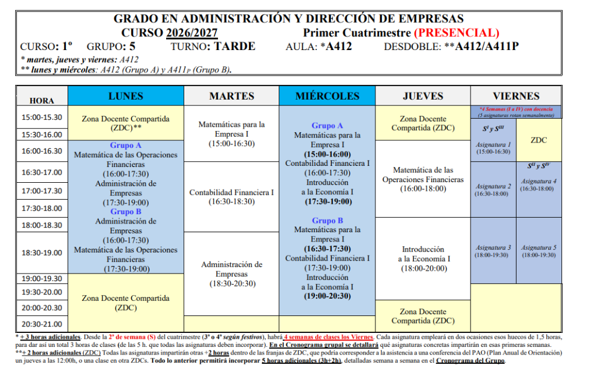

# 🎓 Grado en Administración y Dirección de Empresas (ADE)
### 🏛️ Universidad de Murcia (UM) — Facultad de Economía y Empresa

Repositorio oficial y centralizado de apuntes, prácticas, ejercicios resueltos y preparación de exámenes para el **1.º Curso del Grado en ADE (Plan 2009)**.

---

## 👤 Expediente y Datos Académicos

| Campo | Información Oficial |
| :--- | :--- |
| **Estudiante** | **Santiago Pérez Guerrero** |
| **Correo UMU** | [s.perezguerrero@um.es](mailto:s.perezguerrero@um.es) |
| **Titulación** | **(231) Grado en Administración y Dirección de Empresas** (Plan 2009) |
| **Centro** | Facultad de Economía y Empresa (Campus de Espinardo) |
| **Rama de Conocimiento** | Ciencias Sociales y Jurídicas |
| **Curso Académico** | **2026 / 2027** |
| **Curso y Turno** | **1.º Curso — Turno de TARDE** |
| **Grupo Asignado** | **Grupo 5 — Subgrupo B (5B)** |
| **Aulas de Docencia** | **Aula A412** (Teoría M, J, V) · **Aula A411P** (Prácticas Subgrupo B en L/X) |
| **Coordinadora de Grupo** | **Matilde Lafuente Lechuga** ([mati@um.es](mailto:mati@um.es)) |
| **Régimen de Dedicación** | Tiempo Completo (**60 ECTS** matriculados) |
| **Estado Matrícula** | Formalizada |

---

## 🚨 FECHAS CLAVE: EVALUACIONES CONTINUAS Y PARCIALES (C1)

> [!IMPORTANT]
> ### 📅 Calendario Oficial de Pruebas Parciales (Grupo 5)
> Fechas, horas exactas y asignaturas confirmadas en el cronograma semanal de la Facultad:

| Fecha | Día y Franja Horaria | Asignatura | Prueba | Enlace |
| :--- | :---: | :--- | :--- | :---: |
| 🗓️ **16 de octubre de 2026** | **Viernes** · 16:00 – 17:30 h | **Matemática de las Operaciones Financieras (MOF)** | **PRUEBA I** *(Temas 1 a 5)* | [📁 Carpeta MOF](./Matemática%20de%20las%20Operaciones%20Financieras) |
| 🗓️ **27 de octubre de 2026** | **Martes** · 18:30 – 20:30 h | **Administración de Empresas** | **Prueba parcial** | [📁 Carpeta ADE](./Administración%20de%20Empresas) |
| 🗓️ **3 de noviembre de 2026** | **Martes** · 15:00 – 16:30 h | **Matemáticas para la Empresa I** | **Prueba test** | [📁 Carpeta Mates I](./Matemáticas%20para%20la%20Empresa%20I) |
| 🗓️ **13 de noviembre de 2026** | **Viernes** · 16:00 – 17:30 h | **Matemática de las Operaciones Financieras (MOF)** | **PRUEBA II** | [📁 Carpeta MOF](./Matemática%20de%20las%20Operaciones%20Financieras) |
| 🗓️ **17 de noviembre de 2026** | **Martes** · 16:30 – 18:30 h | **Contabilidad Financiera I** | **Prueba parcial** | [📁 Carpeta Contabilidad I](./Contabilidad%20Financiera%20I) |
| 🗓️ **20 de noviembre de 2026** | **Viernes** · 16:30 – 18:30 h | **Introducción a la Economía I** | **Prueba Parcial Evaluable** | [📁 Carpeta Economía I](./Introducción%20a%20la%20Economía%20I) |

> 🏛️ **Mesas Redondas y Conferencias Obligatorias (Salón de Actos — Jueves 12:30 a 14:30 h):**  
> - **Jueves 8 oct:** *La incapacidad temporal en España* (MOF / Transversal).  
> - **Jueves 22 oct:** *Marketing digital. Más allá del clic* (**Obligatoria ADE**).  
> - **Jueves 29 oct:** *RRHH en la era de la IA: Tecnología con alma de personas* (**Obligatoria Matemáticas I**).  
> - **Jueves 5 nov:** *Consejos de Administración e Internacionalización Empresarial* (**Obligatoria Contabilidad I**).  
> - **Jueves 12 nov:** *Encuentro con empresario/a premio Herentia 2026 de empresa familiar*.  
> 👉 Consulta el **[Cronograma Semanal Grupal Completo](./CRONOGRAMA_SEMANAL_GRUPO_5.md)** y el **[Calendario Oficial de Exámenes](./CALENDARIO_EXAMENES_OFICIALES_2026_2027.md)**.

---

## 🕒 Horario Semanal — Grupo 5 (Turno Tarde · 1.er Cuatrimestre)



> ⏱️ **Regla de los 10 Minutos y Normas de Asistencia:**  
> - Las clases **comienzan 10 minutos después** de la hora oficial (p. ej. a las 16:10 h) y finalizan puntualmente según el horario establecido para facilitar desplazamientos y relevos de aula.  
> - Los desdobles prácticos se iniciaron el **lunes 21 de septiembre**. El subgrupo asignado en MiCampus (**5A** o **5B**) debe mantenerse en todas las asignaturas prácticas.  
> - Cumplimiento del artículo 139 de los Estatutos UMU (máximo rigor ético y prohibición de procedimientos fraudulentos en evaluaciones y trabajos).

> ⚠️ **Aviso de Festivos / No lectivos:**  
> - **Jueves 24 de septiembre:** **NO HAY CLASE** por el *Acto de Apertura del Curso Académico*.  
> - **Lunes 5 de octubre:** Festivo (*Día del Patrón de Veterinaria*).  
> - **Lunes 12 de octubre:** Festivo nacional (*Fiesta Nacional*).

---

## 👨‍🏫 Profesorado del Grupo 5 (1.er Cuatrimestre 2026/2027)

| Cód. | Asignatura | Profesorado | Correo Electrónico |
| :---: | :--- | :--- | :--- |
| **2350** | **Matemáticas para la Empresa I** *(Coordinación)* | **Lafuente Lechuga, Matilde** *(Coordinadora de Grupo)* | [mati@um.es](mailto:mati@um.es) |
| **2343** | **Introducción a la Economía I** | **Sancho Portero, Israel** *(Teoría)*<br>**Siles López, David** *(Práctica)* | [israelsp@um.es](mailto:israelsp@um.es)<br>[david.siles@um.es](mailto:david.siles@um.es) |
| **2344** | **Contabilidad Financiera I** | **García Hernández, Begoña**<br>**Gil Jara, Juan**<br>**García, Jesús** | [bgarcia@um.es](mailto:bgarcia@um.es)<br>[juangiljara@um.es](mailto:juangiljara@um.es)<br>[jesusgas@um.es](mailto:jesusgas@um.es) |
| **2345** | **Administración de Empresas** | **Monllor Domínguez, Jorge**<br>**Peláez Ibarrondo, Juan José** | [jmonllor@um.es](mailto:jmonllor@um.es)<br>[jpelaez@um.es](mailto:jpelaez@um.es) |
| **2346** | **Matemática de las Operaciones Financieras** | **Hernández Carreño, Mª del Rosario**<br>**Hernández Nicolás, Carmen María** | [mrhc@um.es](mailto:mrhc@um.es)<br>[cm.hernandeznicolas@um.es](mailto:cm.hernandeznicolas@um.es) |

---

## 📚 Asignaturas Matriculadas (1.º Curso — 60 ECTS)

### 🍂 Asignaturas Activas en Curso — C1 (28,5 ECTS)

Estas son las **5 asignaturas en las que estás matriculado y cursando actualmente**. Todo el material, apuntes y ejercicios del repositorio están adaptados para que recuperes el mes de retraso y aprendas desde la base:

| Cód. | Asignatura | ECTS | Tipo | Enfoque Pedagógico | Carpeta |
| :---: | :--- | :---: | :---: | :--- | :--- |
| **2344** | **Contabilidad Financiera I** | 6,0 | Formación Básica | Conceptos de patrimonio, partida doble, diario y balance sin matemáticas complejas. | [📁 Ver Asignatura](./Contabilidad%20Financiera%20I) |
| **2345** | **Administración de Empresas** | 6,0 | Formación Básica | 100% conceptual y organizativa (estrategia, PESTEL, Porter, funciones directivas). | [📁 Ver Asignatura](./Administración%20de%20Empresas) |
| **2343** | **Introducción a la Economía I** | 6,0 | Formación Básica | Microeconomía intuitiva: funcionamiento del mercado, oferta, demanda y precios. | [📁 Ver Asignatura](./Introducción%20a%20la%20Economía%20I) |
| **2350** | **Matemáticas para la Empresa I** | 4,5 | Obligatoria | **Nivelación desde cero:** Bloque `0 - Teoría Básica` con explicaciones paso a paso. | [📁 Ver Asignatura](./Matemáticas%20para%20la%20Empresa%20I) |
| **2346** | **Matemática de las Operaciones Financieras** | 6,0 | Formación Básica | Cálculo financiero aplicado a la empresa (préstamos, intereses simples y compuestos). | [📁 Ver Asignatura](./Matemática%20de%20las%20Operaciones%20Financieras) |

> 🗓️ **Fechas de Exámenes Oficiales:**  
> Consulta el calendario completo con fechas, horarios oficiales de 09:00 a 12:00 h y aulas en: **[Calendario Oficial de Exámenes 2026/2027](./CALENDARIO_EXAMENES_OFICIALES_2026_2027.md)**.

> 🚀 **Estrategia para recuperar el mes de retraso:**  
> 1. **Asegurar los puntos fuertes (Economía, Administración y Contabilidad):** Llevar al día los apuntes y supuestos resueltos (Temas 1, 2 y 3 ya implementados con soluciones completas en las tres asignaturas).  
> 2. **Base matemática sólida sin agobios:** Empezar por la carpeta `Matemáticas para la Empresa I/0 - Teoria Basica` para dominar fracciones, potencias y ecuaciones antes de pasar a derivadas y funciones.  
> 3. **Práctica constante guiada:** Resolver los supuestos oficiales paso a paso con las soluciones explicadas en cada tema.

---

## 🗂️ Estructura Estándar por Asignatura

Cada asignatura se organiza de manera modular por bloques temáticos numerados:

```text
Nombre_Asignatura/
├── README.md                 # Ficha técnica, profesorado, horario de clases, temario e índice
├── 0 - Teoria Basica/        # Repaso y nivelación previa
│   ├── Apuntes/              # Guías teóricas explicadas paso a paso y PDFs oficiales
│   └── Prácticas/            # Boletines y supuestos prácticos
├── 1 - Nombre del Tema/      # Bloques de contenidos oficiales
│   ├── Apuntes/
│   └── Prácticas/
└── Exámenes/                 # Exámenes parciales, finales y autoevaluaciones globales
```

---

## 🛠️ Herramientas Digitales de Estudio (Lienzos y Cálculo)

Recursos clave para trabajar y operar cómodamente desde Mac o PC de sobremesa:

- 🎨 **[tldraw](https://tldraw.com)** — **Lienzo Digital Principal:** Pizarra infinita con suavizado de trazo (*perfect-freehand*). Permite dibujar operaciones a mano alzada con el ratón o trackpad con total fluidez, pegar capturas de los ejercicios de clase con `Ctrl+V` / `Cmd+V` y resolverlos directamente encima con rotulador y colores.
- 📐 **[GeoGebra Calculadora](https://www.geogebra.org/calculator)** / **[GeoGebra 3D](https://www.geogebra.org/3d)** — Software interactivo para graficar funciones polinómicas, rectas presupuestarias, curvas de nivel 3D e isocuantas de producción.
- 🧮 **[Symbolab](https://es.symbolab.com/)** — Solucionador paso a paso para verificar operaciones de matrices, determinantes, sistemas de ecuaciones lineales y derivadas.
- 📊 **[Desmos](https://www.desmos.com/calculator?lang=es)** — Graficadora rápida en 2D para modelos económicos (equilibrio de mercado, costes y beneficios).
- 📝 **[Obsidian](https://obsidian.md/)** — Gestor de conocimiento en Markdown que permite abrir este repositorio como bóveda y utilizar **Obsidian Canvas** para conectar apuntes y PDFs visualmente.

---

## 🔗 Portales y Servicios Oficiales de la UM

- 💻 **[Aula Virtual UM (Sakai)](https://aulavirtual.um.es/)** — Acceso diario a contenidos docentes, tareas y calificaciones.
- 📱 **[MiCampus UM](https://micampus.um.es/)** — Portal del estudiante, resguardo definitivo, horarios y expediente académico.
- 📑 **[Sede Electrónica — Carpeta Ciudadana](https://sede.um.es/carpeta)** — Notificaciones electrónicas y trámites administrativos.
- 🔍 **[Validador de Documentos UMU](https://sede.um.es/validador/)** — Cotejo de autenticidad de resguardos y certificados con CSV.
- 🏛️ **[Facultad de Economía y Empresa](https://www.um.es/web/economiayempresa/)** — Noticias, calendarios de exámenes y secretaría del centro.
- 📋 **[Plan de Estudios y Guías Docentes](./PLAN_ESTUDIOS_UM.md)** — Consulta íntegra de la estructura del título.